# ResumeLens – System Design

This document describes the general design of ResumeLens: the architecture of the pipeline, the structure of the project, the modules of each stage with their inputs and outputs, and the general design decisions. The detailed design of each stage is in its own document (Section 7).

---

## 1. Architecture of the Pipeline

ResumeLens processes a résumé written in plain text through four stages. Each stage applies one formal model and produces a data structure that is the input of the next stage.

```mermaid
flowchart LR
    TXT["Résumé (.txt)"] --> S1

    subgraph S1["Stage 1 · Extraction"]
        RE["Regular expressions<br/>resume_extractor.py"]
    end

    S1 -- ExtractedData --> S2

    subgraph S2["Stage 2 · Normalization"]
        FST["Finite-state transducers<br/>resume_normalizer.py"]
    end

    S2 -- NormalizedData --> S3

    subgraph S3["Stage 3 · Classification"]
        DFA["Finite automata<br/>profile_automata.py"]
    end

    S3 -- "dict profile → ACCEPTED / REJECTED" --> S4

    subgraph S4["Stage 4 · Candidate profile"]
        GEN["ProfileGenerator"] -- "DSL text (.rl)" --> VAL["ProfileValidator<br/>(textX + CFG)"]
        VAL -- "textX model" --> VIS["ProfileVisualizer"]
    end

    VIS --> HTML["Visualization (.html)"]
```



The same flow in text:

```text
résumé.txt
   │  Stage 1 – regular expressions        (extract_resume_information)
   ▼
ExtractedData
   │  Stage 2 – finite-state transducers   (ResumeNormalizer.normalize)
   ▼
NormalizedData  (canonical tokens + one sorted sequence per profile)
   │  Stage 3 – finite automata            (ProfileAutomata.classify)
   ▼
{profile: ACCEPTED | REJECTED}
   │  Stage 4 – context-free grammar       (ProfileGenerator.generate)
   ▼
DSL text (.rl)
   │                                       (ProfileValidator.validate)
   ▼
textX model  ── or ──  TextXSyntaxError / TextXSemanticError (line, column)
   │                                       (ProfileVisualizer.render)
   ▼
HTML page (.html)
```

The order is fixed because each stage depends on the output of the previous one:

| Stage | Formal model | Question it answers |
| :--- | :--- | :--- |
| 1. Extraction | Regular expressions | *What* qualifications and candidate data appear in the text? |
| 2. Normalization | Finite-state transducers | *Which canonical qualification* does each written variant represent? |
| 3. Classification | Finite automata (DFA) | Does the sequence of qualifications satisfy the *pattern* of each profile? |
| 4. Candidate profile | Context-free grammar (textX) | Is the resulting candidate information *well structured*? How is it shown? |

Each stage has only one responsibility: extraction does not decide equivalences, normalization does not classify, and classification does not validate the structure of the final profile.

---

## 2. Project Structure

```text
ResumeLens/
├── src/
│   ├── pipeline.py                     # entry point (command line UI)
│   ├── model/
│   │   ├── extraction/                 # Stage 1
│   │   │   ├── regex_patterns.py
│   │   │   ├── resume_extractor.py
│   │   │   └── extracted_data.py
│   │   ├── normalization/              # Stage 2
│   │   │   ├── normalization_vocabulary.py
│   │   │   ├── normalization_transducers.py
│   │   │   ├── resume_normalizer.py
│   │   │   └── normalized_data.py
│   │   ├── classification/             # Stage 3
│   │   │   ├── profile_vocabulary.py
│   │   │   └── profile_automata.py
│   │   └── grammar/                    # Stage 4
│   │       ├── resume_lens.tx
│   │       ├── profile_generator.py
│   │       └── profile_validator.py
│   └── visualization/                  # Stage 4 (output)
│       └── profile_visualizer.py
├── tests/                              # one folder per stage + end-to-end
├── data/
│   ├── resumes/                        # example résumés (.txt), input of the pipeline
│   ├── expected/                       # expected result of each example résumé (.json)
│   ├── profiles/                       # hand-written profiles (.rl), valid and invalid
│   └── output/                         # files generated by the pipeline (not versioned)
├── diagrams/
│   ├── fst/                            # transducer diagrams (.dot, .svg)
│   └── automata/                       # automaton diagrams (.dot, .svg)
└── docs/                               # design documents
```

The code follows the separation **model / visualization / entry point**: `src/model` contains the four formal models and does not print or write files; `src/visualization` only builds the HTML; `src/pipeline.py` connects everything and is the only module that reads résumés, writes files, and prints to the console.

---

## 3. Modules, Inputs, and Outputs

### 3.1 Stage 1 – Extraction (`src/model/extraction`)

| Element | Description |
| :--- | :--- |
| `regex_patterns.py` | Regular expression of each category (name, email, phone, languages, frameworks, databases, academic, experience, tools, other). It only defines patterns. |
| `extract_resume_information(text)` | Applies every pattern with Python's `re` module. |
| **Input** | `str` – complete text of the résumé. |
| **Output** | `ExtractedData` – name, emails, phones, and one list of strings per category, **exactly as written** (`"JS"`, `"React.js"`, `"Postgres"`). |

Design: [`05_regex_design.md`](05_regex_design.md).

### 3.2 Stage 2 – Normalization (`src/model/normalization`)

| Element | Description |
| :--- | :--- |
| `NormalizationVocabulary` | Tables *variant → canonical token* of each category (`"react.js" → REACT`). |
| `NormalizationTransducers` | Builds the seven transducers with `pyformlang` (`M_LANG`, `M_FW`, `M_DB`, `M_TOOLS`, `M_OTHER`, `M_ACAD`, `M_EXP`) and translates strings. |
| `ResumeNormalizer.normalize(extracted)` | Translates every extracted string, removes duplicates, and builds the sorted sequence of each profile. |
| **Input** | `ExtractedData` |
| **Output** | `NormalizedData` – canonical tokens by category, years of experience, experience entries, all the qualifications, and `profile_sequences`: one **sorted sequence per profile** (input of the automata). |

Design: [`06_fst_design.md`](06_fst_design.md), formal definitions: [`06a_fst_formal_definitions.md`](06a_fst_formal_definitions.md).

### 3.3 Stage 3 – Classification (`src/model/classification`)

| Element | Description |
| :--- | :--- |
| `ProfileVocabulary` | Groups of equivalent tokens of each profile, their order, and which groups are optional. |
| `ProfileAutomata` | Builds one DFA per profile with `pyformlang` (`A_FS`, `A_ML`, `A_SEC`, `A_DE`). |
| `ProfileAutomata.classify(normalized)` | Runs each automaton on the sequence of its profile. |
| **Input** | `NormalizedData` (only `profile_sequences` is used). |
| **Output** | `dict[str, str]` – `{"FULL_STACK_DEVELOPER": "ACCEPTED", "MACHINE_LEARNING_ENGINEER": "REJECTED", ...}` |

Design: [`07_automata_design.md`](07_automata_design.md), profiles: [`04_profiles.md`](04_profiles.md).

### 3.4 Stage 4 – Candidate profile (`src/model/grammar`, `src/visualization`)

| Element | Input | Output |
| :--- | :--- | :--- |
| `ProfileGenerator.generate(normalized, classification)` | `NormalizedData` + classification `dict` | `str` – profile written in the candidate profile language (DSL, `.rl`) |
| `ProfileValidator.validate(text)` | DSL text | textX **model**, or `TextXSyntaxError` / `TextXSemanticError` with line and column |
| `ProfileVisualizer.render(model)` | textX model | `str` – HTML page of the candidate |

The grammar is in `resume_lens.tx`. Design: [`08_grammar_design.md`](08_grammar_design.md).

### 3.5 Entry point (`src/pipeline.py`)

| Element | Description |
| :--- | :--- |
| `ResumePipeline` | Builds the transducers, automata, grammar, and visualizer **once** and processes any number of résumés. |
| `ResumePipeline.process_file(path)` | Runs the four stages on a `.txt` file and writes `<name>.rl` and `<name>.html`. Returns a `PipelineResult` with the output of every stage. |
| `python -m src.pipeline <file or folder>` | Command line interface: prints a summary of every stage and the files generated. |

If the generated profile does not satisfy the grammar, the error is shown with its line and column and the HTML is not generated.

---

## 4. Data Types Between Stages

```text
str ──► ExtractedData ──► NormalizedData ──► dict[str, str] ──► str (DSL) ──► textX model ──► str (HTML)
     1                 2                  3                 4a           4b              4c
```

| Type | Defined in | Main fields |
| :--- | :--- | :--- |
| `ExtractedData` | `extraction/extracted_data.py` | `name`, `emails`, `phones`, `programming_languages`, `frameworks_libraries`, `databases`, `academic_qualifications`, `professional_experience`, `tools_technologies`, `other_qualifications` |
| `NormalizedData` | `normalization/normalized_data.py` | the same categories with canonical tokens, `experience_years`, `experience_entries`, `qualifications`, `profile_sequences` |
| Classification | `dict[str, str]` | profile → `ACCEPTED` / `REJECTED`, always the four profiles |
| Candidate profile | DSL text | `candidate "..." { contact {...} experience {...} education {...} skills {...} classification {...} }` |
| textX model | Generated by textX from `resume_lens.tx` | `model.name`, `model.contact`, `model.experience`, `model.education`, `model.skills`, `model.classification` |

The data structures are `dataclasses`, so every stage can be tested independently by building its input by hand.

---

## 5. General Design Decisions

1. **One general solution for the four profiles.** As required by the statement, the four profiles are processed by the same code: the same extractor, the same transducers, the same automaton structure (one state per group, loops for repeated tokens, and skip transitions for optional groups), and the same grammar. The four profiles differ only in their data (their groups in `ProfileVocabulary`), not in separate implementations of the pipeline.

2. **A single definition of the profile groups.** The groups of each profile are defined only in `ProfileVocabulary.GROUPS`. Stage 2 uses them to sort the tokens of each profile, and stage 3 uses them to build the transitions of the automata. Therefore the order of the sequence and the order expected by the automaton can never be different.

3. **Canonical tokens as the alphabet.** After stage 2, every qualification is a canonical token (`JAVASCRIPT`, `NODE_JS`, `GIT`). These tokens are the output alphabet Γ of the transducers, the alphabet Σ of the automata, and the `TOKEN` terminal of the grammar, so the three models share the same vocabulary.

4. **Canonical order per profile.** Before classification, the tokens are sorted in the order of the groups of each profile. The result does not depend on the order in which the candidate wrote the skills, and the automata can be simple sequences of groups (DFA).

5. **Validation before visualization.** The visualizer receives the textX model, never the raw text. A profile is shown only if it satisfies the lexical, syntactic, and semantic rules of the grammar.

6. **Formal models implemented with libraries required by the statement.** Regular expressions with `re`, transducers and automata with `pyformlang`, and the grammar with `textX`.

7. **The application does not rank or hire.** As the statement says, ResumeLens only checks whether the qualifications **explicitly written** in a résumé satisfy the patterns of each profile. A candidate can be accepted in several profiles or in none.

---

## 6. Inputs and Outputs of the Application

| | Location | Format |
| :--- | :--- | :--- |
| Input | `data/resumes/*.txt` (or any path) | Résumé in plain text, in English |
| Output | `data/output/<name>.rl` | Candidate profile in the DSL |
| Output | `data/output/<name>.html` | Visualization of the candidate (only if the profile is valid) |
| Output | Console | Summary of every stage: extracted values, normalized tokens, sequence and result of each profile, validation |

---

## 7. Design Documents

| Document | Content |
| :--- | :--- |
| [`01_problem_definition.md`](01_problem_definition.md) | Problem, objectives, and scope |
| [`02_literature_review.md`](02_literature_review.md) | Literature review of each formal model |
| `03_system_design.md` | This document |
| [`04_profiles.md`](04_profiles.md) | The four professional profiles |
| [`05_regex_design.md`](05_regex_design.md) | Stage 1 – regular expressions |
| [`06_fst_design.md`](06_fst_design.md) | Stage 2 – finite-state transducers |
| [`06a_fst_formal_definitions.md`](06a_fst_formal_definitions.md) | Stage 2 – 7-tuple of every transducer |
| [`07_automata_design.md`](07_automata_design.md) | Stage 3 – finite automata |
| [`08_grammar_design.md`](08_grammar_design.md) | Stage 4 – grammar, validation, and visualization |
| [`09_test_design.md`](09_test_design.md) | Test design and scenarios |
