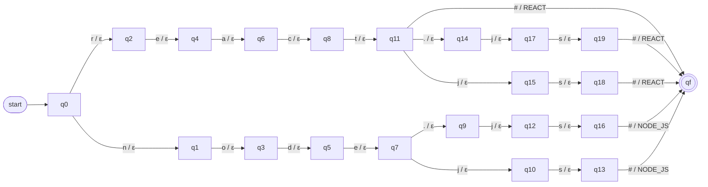
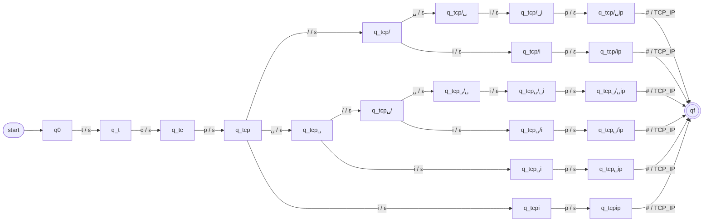
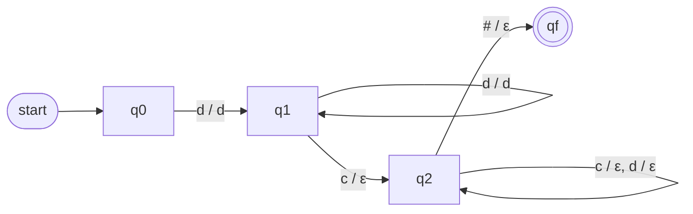

# ResumeLens – Finite-State Transducer Normalization Stage

## 1. Purpose of the Stage

The extraction stage (see `05_regex_design.md`) preserves every qualification exactly as it appears in the resume. As a consequence, the same qualification can arrive in several different forms:

```text
JS, Javascript, JavaScript
React, React.js, ReactJS
Postgres, PostgreSQL
```

The normalization stage receives these raw strings and transforms every equivalent variant into a single **canonical token**:

```text
JS          -> JAVASCRIPT
Javascript  -> JAVASCRIPT
React.js    -> REACT
ReactJS     -> REACT
NodeJS      -> NODE_JS
Postgres    -> POSTGRESQL
```

These transformations are modeled with **Finite-State Transducers (FST)** and implemented with `pyformlang`.

After normalization, the canonical tokens are **sorted according to the canonical order of each professional profile**, so that the next stage (finite automata) receives a sequence that does not depend on the order in which the candidate wrote the information.

```text
Extraction (regex)  ->  Normalization (FST)  ->  Sorting by profile  ->  Recognition (automata)
```

This stage does **not** decide whether the candidate satisfies a profile. It only transforms and organizes the information.

---

## 2. Requirements of the Stage

According to the project statement, for each transducer the team must:

- Provide the formal definition (complete 7-tuple): `M = (Q, Σ, Γ, δ, ω, q0, F)`.
- Clearly define the set of states `Q`, the input alphabet `Σ`, the output alphabet `Γ`, the transition relation `δ`, the output relation `ω`, the initial state `q0`, and the set of accepting states `F`.
- Provide a graphical representation of the transducers.
- Implement the transformations using `pyformlang`.
- Propose its own transformations (the ones in the statement are only examples).
- Prepare the normalized qualifications for the recognition stage, organizing them in the canonical order defined by each profile.

Where each requirement is satisfied:

| Requirement | Where |
| :--- | :--- |
| Complete 7-tuple of each transducer (`Q`, `Σ`, `Γ`, `δ`, `ω`, `q0`, `F`) | Section 6 (summary of each transducer) and `06a_fst_formal_definitions.md` (complete lists of states and complete `δ` / `ω` tables) |
| Graphical representation | Section 6 (diagrams in this document) and `diagrams/fst/*.svg` (complete diagram of every transducer) |
| Implementation with `pyformlang` | Class `NormalizationTransducers` in `src/model/normalization/normalization_transducers.py` (Section 9) |
| Own transformations | Section 4, class `NormalizationVocabulary` (the vocabulary extends the examples of the statement with the variants of the four profiles) |
| Canonical order by profile | Section 7, `ResumeNormalizer.sort_for_profile` (with the groups of `ProfileVocabulary`) |

`06a_fst_formal_definitions.md` and `diagrams/fst/` were **generated from the transducers built by the code**, so the formal definitions and the diagrams correspond to the implementation. The number of states of every transducer is checked by the unit tests (Section 11).

---

## 3. Design Decisions

### 3.1 One transducer per category

Instead of building one large transducer for the whole vocabulary, ResumeLens uses **one transducer per extraction category**:

| Transducer | Input (field of `ExtractedData`) |
| :--- | :--- |
| `M_LANG` | `programming_languages` |
| `M_FW` | `frameworks_libraries` |
| `M_DB` | `databases` |
| `M_TOOLS` | `tools_technologies` |
| `M_OTHER` | `other_qualifications` |
| `M_ACAD` | `academic_qualifications` |
| `M_EXP` | `professional_experience` |

Reasons:

- Each transducer is smaller, so it is easier to define formally, draw, and test.
- The categories of the extraction stage are preserved, which keeps the separation of responsibilities between stages.
- Adding a new variant only modifies the transducer of its category.

The candidate name and the contact information (emails and phone numbers) are **not normalized**, because they do not represent qualifications. They are copied without changes to the output of the stage (Section 8), so that the candidate-profile stage (DSL) receives all the candidate information in one object.

### 3.2 Character-level transducers

The transducers read the input **one character at a time**. Each transition reads exactly one symbol of `Σ`.

For example, the input `React.js` is read as:

```text
r, e, a, c, t, ., j, s
```

This makes the transducers real finite-state machines over an alphabet of characters, instead of a simple dictionary lookup of complete words.

### 3.3 Preprocessing before the transducer

Before entering a transducer, every extracted string is prepared with three simple operations:

1. Convert to lowercase: `React.js -> react.js`.
2. Replace the typographic apostrophe `’` with `'`: `Bachelor’s -> bachelor's`.
3. Remove spaces at the beginning and end, and replace any sequence of whitespace with a single space: `Spring   Boot -> spring boot`.

This decision reduces the size of the input alphabet `Σ` (only lowercase letters are needed) and the number of states, because the regex stage already accepted these variations (it uses `re.IGNORECASE` and `\s+`).

### 3.4 End-of-input marker `#`

Some variants are prefixes of other variants:

```text
react      -> REACT
react.js   -> REACT
machine learning                      -> MACHINE_LEARNING
machine learning model development    -> ML_MODEL_DEVELOPMENT
```

When the transducer finishes reading `react`, it cannot know yet whether the input ends there or continues with `.js`. To solve this, the special symbol `#` is appended at the end of every input:

```text
react.js  ->  r e a c t . j s #
```

The canonical token is produced **only when `#` is read**. This keeps every transducer deterministic: from each state, each input symbol has at most one transition.

### 3.5 Output alphabet made of canonical tokens

Each symbol of the output alphabet `Γ` is a complete canonical token (for example `REACT` or `NODE_JS`).

- Every transition that reads a normal character produces the empty string `ε`.
- The transition that reads `#` produces exactly one symbol of `Γ`: the canonical token.

Therefore, for every accepted input, the output is a string of length 1 over `Γ`.

The exception is `M_EXP` (Section 6.7), which copies digits to the output.

### 3.6 Inputs that are not recognized

If a string has no path from `q0` to the accepting state `qf`, the transducer **rejects** it and produces no output.

In theory this should not happen, because the vocabulary of each transducer is the same as the vocabulary of the corresponding regular expression. If it happens, the normalizer ignores the string and does not add any token.

### 3.7 Duplicates and `SQL`

- If the same qualification appears more than once in the resume (for example `JS` and `JavaScript`), both are transformed to `JAVASCRIPT`, and the normalizer keeps **only one** occurrence.
- `SQL` is extracted both as a programming language and as a database. Both `M_LANG` and `M_DB` transform it to the same token `SQL`, and the duplicate is removed. In this way, `SQL` appears only once in the final sequence.

---

## 4. Canonical Vocabulary

The tables show the input variants (after preprocessing) and their canonical token. In the code they are the dictionaries of the class `NormalizationVocabulary` (`normalization_vocabulary.py`), and the transducers are built from them.

### 4.1 Programming languages — `M_LANG`

| Input variants | Canonical token |
| :--- | :--- |
| `javascript`, `js` | `JAVASCRIPT` |
| `typescript` | `TYPESCRIPT` |
| `python` | `PYTHON` |
| `sql` | `SQL` |
| `bash` | `BASH` |

### 4.2 Frameworks and libraries — `M_FW`

| Input variants | Canonical token |
| :--- | :--- |
| `react`, `react.js`, `reactjs` | `REACT` |
| `angular` | `ANGULAR` |
| `vue` | `VUE` |
| `node.js`, `nodejs` | `NODE_JS` |
| `django` | `DJANGO` |
| `spring boot` | `SPRING_BOOT` |
| `pandas` | `PANDAS` |
| `numpy` | `NUMPY` |
| `scikit-learn`, `scikit learn`, `scikitlearn`, `sklearn` | `SCIKIT_LEARN` |
| `tensorflow`, `tensor flow` | `TENSORFLOW` |
| `pytorch`, `py torch` | `PYTORCH` |
| `apache spark`, `spark` | `SPARK` |
| `apache airflow`, `airflow` | `AIRFLOW` |

`sklearn` is included because it is one of the examples of the project statement (`sklearn -> SCIKIT_LEARN`). See Section 12 about the extraction stage.

### 4.3 Databases — `M_DB`

| Input variants | Canonical token |
| :--- | :--- |
| `postgresql`, `postgres` | `POSTGRESQL` |
| `nosql` | `NOSQL` |
| `sql` | `SQL` |

### 4.4 Tools and technologies — `M_TOOLS`

| Input variants | Canonical token |
| :--- | :--- |
| `git` | `GIT` |
| `docker` | `DOCKER` |
| `kubernetes` | `KUBERNETES` |
| `nmap` | `NMAP` |
| `linux` | `LINUX` |
| `tcp/ip`, `tcp ip`, `tcp / ip`, `tcp /ip`, `tcp/ ip`, `tcpip` | `TCP_IP` |
| `networking`, `network` | `NETWORKING` |
| `etl` | `ETL` |
| `elt` | `ELT` |
| `data pipeline`, `data pipelines` | `DATA_PIPELINE` |
| `data warehouse`, `data warehousing` | `DATA_WAREHOUSING` |

### 4.5 Other qualifications — `M_OTHER`

| Input variants | Canonical token |
| :--- | :--- |
| `machine learning`, `machine-learning` | `MACHINE_LEARNING` |
| `machine learning model development`, `machine-learning model development` | `ML_MODEL_DEVELOPMENT` |
| `rest api`, `rest apis` | `REST_API` |
| `vulnerability assessment` | `VULNERABILITY_ASSESSMENT` |
| `cybersecurity`, `cyber security` | `CYBERSECURITY` |
| `security automation` | `SECURITY_AUTOMATION` |

### 4.6 Academic qualifications — `M_ACAD`

| Input variants | Canonical token |
| :--- | :--- |
| `bachelor`, `bachelor's`, `bsc`, `bsc.`, `b.sc`, `b.sc.` | `BACHELOR` |
| `master`, `master's`, `msc`, `msc.`, `m.sc`, `m.sc.` | `MASTER` |
| `phd`, `phd.`, `ph.d`, `ph.d.` | `PHD` |
| `computer science` | `COMPUTER_SCIENCE` |
| `software engineering` | `SOFTWARE_ENGINEERING` |
| `systems engineering` | `SYSTEMS_ENGINEERING` |
| `data science` | `DATA_SCIENCE` |

### 4.7 Professional experience — `M_EXP`

| Input example | Output |
| :--- | :--- |
| `3 years of experience` | `3` |
| `5+ yrs experience` | `5` |
| `2 yrs of experience` | `2` |
| `4 years of professional experience` | `4` |
| `3years experience` | `3` |

`M_EXP` keeps only the number of years. The value is stored as an integer (`experience_years`). The words of the expression (`years`, `of`, `experience`) are validated by `EXPERIENCE_PATTERN` in the extraction stage, so `M_EXP` only has to separate the number from the rest.

---

## 5. General Construction of the Dictionary Transducers

The transducers `M_LANG`, `M_FW`, `M_DB`, `M_TOOLS`, `M_OTHER`, and `M_ACAD` are built with the same method. Each one is a **prefix-tree transducer**: there is one state for every prefix of the input variants, so variants that start the same way share states (for example `react`, `react.js`, and `reactjs` share the states of `r`, `re`, `rea`, `reac`, `react`).

Let `V` be the set of input variants of the transducer and `T : V -> Γ` the table that assigns a canonical token to each variant (Section 4).

The formal definition is:

```text
M = (Q, Σ, Γ, δ, ω, q0, F)
```

where:

```text
Q   = { q_p | p is a prefix of some word of V }  ∪  { qf }
      (q_ε is the state of the empty prefix)

Σ   = { characters that appear in the words of V }  ∪  { # }

Γ   = { T(w) | w ∈ V }                       (the canonical tokens)

δ   : transition relation
      δ(q_p, a)  = q_pa     if pa is a prefix of some word of V
      δ(q_w, #)  = qf       if w ∈ V

ω   : output relation (output produced by each transition)
      ω(q_p, a)  = ε
      ω(q_w, #)  = T(w)

q0  = q_ε

F   = { qf }
```

Properties of this construction:

- **Deterministic:** for each state and each input symbol there is at most one transition.
- **Number of states:** `|Q| = (number of different prefixes of V, including ε) + 1`.
- **Number of transitions:** `(|Q| - 2) + |V|`, that is, one transition for each non-empty prefix plus one `#` transition for each variant.
- **Translation:** for every `w ∈ V`, the transducer translates `w#` into `T(w)`. Any other input is rejected.
- **Linear time:** a string of length `n` is translated with `n + 1` transitions.

In the code, the transducers are **generated automatically** from the tables of Section 4 (see Section 9), so the tables and the transducers cannot be different.

The complete instance of the construction for every transducer (list of states with the prefix that each one represents, and the complete `δ` / `ω` table) is in `06a_fst_formal_definitions.md`.

---

## 6. Transducers

### 6.1 Databases — `M_DB`

This transducer is presented completely as the reference example. The other dictionary transducers follow exactly the same construction; their complete tables are in `06a_fst_formal_definitions.md`. Complete diagram: `diagrams/fst/m_db.svg`.

```text
V = { postgresql, postgres, nosql, sql }
```

#### Formal definition

```text
M_DB = (Q, Σ, Γ, δ, ω, q0, F)

Q  = { q0, q1, ..., q18, qf }        (20 states)
Σ  = { e, g, l, n, o, p, q, r, s, t, # }
Γ  = { POSTGRESQL, NOSQL, SQL }
q0 = q0
F  = { qf }
```

Each state represents the prefix that has been read:

| State | Prefix read | State | Prefix read |
| :--- | :--- | :--- | :--- |
| `q0` | `ε` | `q10` | `nosq` |
| `q1` | `n` | `q11` | `post` |
| `q2` | `p` | `q12` | `nosql` |
| `q3` | `s` | `q13` | `postg` |
| `q4` | `no` | `q14` | `postgr` |
| `q5` | `po` | `q15` | `postgre` |
| `q6` | `sq` | `q16` | `postgres` |
| `q7` | `nos` | `q17` | `postgresq` |
| `q8` | `pos` | `q18` | `postgresql` |
| `q9` | `sql` | `qf` | accepting state |

#### Transition relation `δ` and output relation `ω`

| From | Input | To | Output |
| :--- | :--- | :--- | :--- |
| `q0` | `n` | `q1` | `ε` |
| `q0` | `p` | `q2` | `ε` |
| `q0` | `s` | `q3` | `ε` |
| `q1` | `o` | `q4` | `ε` |
| `q2` | `o` | `q5` | `ε` |
| `q3` | `q` | `q6` | `ε` |
| `q4` | `s` | `q7` | `ε` |
| `q5` | `s` | `q8` | `ε` |
| `q6` | `l` | `q9` | `ε` |
| `q7` | `q` | `q10` | `ε` |
| `q8` | `t` | `q11` | `ε` |
| `q10` | `l` | `q12` | `ε` |
| `q11` | `g` | `q13` | `ε` |
| `q13` | `r` | `q14` | `ε` |
| `q14` | `e` | `q15` | `ε` |
| `q15` | `s` | `q16` | `ε` |
| `q16` | `q` | `q17` | `ε` |
| `q17` | `l` | `q18` | `ε` |
| `q18` | `#` | `qf` | `POSTGRESQL` |
| `q16` | `#` | `qf` | `POSTGRESQL` |
| `q12` | `#` | `qf` | `NOSQL` |
| `q9` | `#` | `qf` | `SQL` |

Any pair (state, symbol) that does not appear in the table has no transition, so the input is rejected.

#### Graphical representation


#### Example of translation

Input extracted from the resume: `Postgres`.

```text
Preprocessing:  postgres
Input tape:     p o s t g r e s #
```

| Step | State | Reads | Next state | Writes |
| :--- | :--- | :--- | :--- | :--- |
| 1 | `q0` | `p` | `q2` | `ε` |
| 2 | `q2` | `o` | `q5` | `ε` |
| 3 | `q5` | `s` | `q8` | `ε` |
| 4 | `q8` | `t` | `q11` | `ε` |
| 5 | `q11` | `g` | `q13` | `ε` |
| 6 | `q13` | `r` | `q14` | `ε` |
| 7 | `q14` | `e` | `q15` | `ε` |
| 8 | `q15` | `s` | `q16` | `ε` |
| 9 | `q16` | `#` | `qf` | `POSTGRESQL` |

The transducer ends in `qf ∈ F`, so the input is accepted and the output is `POSTGRESQL`.

Example of rejection: `mysql` has no transition from `q0` with `m`, so it is rejected.

### 6.2 Programming languages — `M_LANG`

```text
M_LANG = (Q, Σ, Γ, δ, ω, q0, F)

V  = { javascript, js, typescript, python, sql, bash }
Σ  = { a, b, c, e, h, i, j, l, n, o, p, q, r, s, t, v, y, # }
Γ  = { JAVASCRIPT, TYPESCRIPT, PYTHON, SQL, BASH }
Q  = { q0, q1, ..., q34, qf }    (36 states: one per prefix of V, plus qf;
                                      the prefix of each state is listed in 06a)
q0 = q_ε
F  = { qf }
δ, ω: construction of Section 5 with the table of Section 4.1
      (40 transitions, complete table in 06a_fst_formal_definitions.md)
```

Complete diagram: `diagrams/fst/m_lang.svg`.

Note that `javascript` and `js` share the state of the prefix `j`, and both end with the output `JAVASCRIPT`.


### 6.3 Frameworks and libraries — `M_FW`

```text
M_FW = (Q, Σ, Γ, δ, ω, q0, F)

V  = the 23 variants of Section 4.2
Σ  = { space, -, ., a, b, c, d, e, f, g, h, i, j, k, l, m, n, o, p, r, s, t, u, v, w, y, # }
Γ  = { REACT, ANGULAR, VUE, NODE_JS, DJANGO, SPRING_BOOT, PANDAS, NUMPY,
       SCIKIT_LEARN, TENSORFLOW, PYTORCH, SPARK, AIRFLOW }
Q  = { q0, q1, ..., q138, qf }    (140 states: one per prefix of V, plus qf;
                                      the prefix of each state is listed in 06a)
q0 = q_ε
F  = { qf }
δ, ω: construction of Section 5 with the table of Section 4.2
      (161 transitions, complete table in 06a_fst_formal_definitions.md)
```

Because the complete diagram has 140 states, the document shows the fragment of the `REACT` and `NODE_JS` variants. The complete diagram is `diagrams/fst/m_fw.svg`.



The fragment shows the two main ideas of the design:

- `react`, `react.js`, and `reactjs` share the first five states.
- The output `REACT` is produced only when `#` is read, so `react` (state after `t`) and `react.js` can both be accepted without ambiguity.

### 6.4 Tools and technologies — `M_TOOLS`

```text
M_TOOLS = (Q, Σ, Γ, δ, ω, q0, F)

V  = the 19 variants of Section 4.4
Σ  = { space, /, a, b, c, d, e, g, h, i, k, l, m, n, o, p, r, s, t, u, w, x, # }
Γ  = { GIT, DOCKER, KUBERNETES, NMAP, LINUX, TCP_IP, NETWORKING, ETL, ELT,
       DATA_PIPELINE, DATA_WAREHOUSING }
Q  = { q0, q1, ..., q87, qf }    (89 states: one per prefix of V, plus qf;
                                      the prefix of each state is listed in 06a)
q0 = q_ε
F  = { qf }
δ, ω: construction of Section 5 with the table of Section 4.4
      (106 transitions, complete table in 06a_fst_formal_definitions.md)
```

Complete diagram: `diagrams/fst/m_tools.svg`. Fragment for the `TCP_IP` variants:



(`␣` represents the space character.)

### 6.5 Other qualifications — `M_OTHER`

```text
M_OTHER = (Q, Σ, Γ, δ, ω, q0, F)

V  = the 10 variants of Section 4.5
Σ  = { space, -, a, b, c, d, e, g, h, i, l, m, n, o, p, r, s, t, u, v, y, # }
Γ  = { MACHINE_LEARNING, ML_MODEL_DEVELOPMENT, REST_API,
       VULNERABILITY_ASSESSMENT, CYBERSECURITY, SECURITY_AUTOMATION }
Q  = { q0, q1, ..., q135, qf }    (137 states: one per prefix of V, plus qf;
                                      the prefix of each state is listed in 06a)
q0 = q_ε
F  = { qf }
δ, ω: construction of Section 5 with the table of Section 4.5
      (145 transitions, complete table in 06a_fst_formal_definitions.md)
```

Complete diagram: `diagrams/fst/m_other.svg`.

This transducer shows why the `#` marker is necessary: `machine learning` is a prefix of `machine learning model development`. In the state reached after `machine learning`:

- if the next symbol is `#`, the output is `MACHINE_LEARNING`;
- if the next symbol is a space, the transducer continues reading `model development`, and later produces `ML_MODEL_DEVELOPMENT`.

### 6.6 Academic qualifications — `M_ACAD`

```text
M_ACAD = (Q, Σ, Γ, δ, ω, q0, F)

V  = the 20 variants of Section 4.6
Σ  = { space, ', ., a, b, c, d, e, f, g, h, i, l, m, n, o, p, r, s, t, u, w, y, # }
Γ  = { BACHELOR, MASTER, PHD, COMPUTER_SCIENCE, SOFTWARE_ENGINEERING,
       SYSTEMS_ENGINEERING, DATA_SCIENCE }
Q  = { q0, q1, ..., q105, qf }    (107 states: one per prefix of V, plus qf;
                                      the prefix of each state is listed in 06a)
q0 = q_ε
F  = { qf }
δ, ω: construction of Section 5 with the table of Section 4.6
      (125 transitions, complete table in 06a_fst_formal_definitions.md)
```

Complete diagram: `diagrams/fst/m_acad.svg`. Fragment for the `PHD` variants:


### 6.7 Professional experience — `M_EXP`

This transducer is different from the others. It does not map a complete word to a token; it **copies the digits** of the number of years to the output and **erases** the rest of the expression.

It does not need to check the words of the expression: every input of `M_EXP` comes from `EXPERIENCE_PATTERN` (extraction stage), which already guarantees the structure `number (+)? (year|years|yr|yrs) (of)? (professional)? experience`. The responsibility of `M_EXP` is only to transform the expression into the number of years.

#### Formal definition

```text
M_EXP = (Q, Σ, Γ, δ, ω, q0, F)

Q  = { q0, q1, q2, qf }                                        (4 states)

Σ  = Digit ∪ Letter ∪ { +, space, # }                           (39 symbols)
     Digit  = { 0, 1, 2, 3, 4, 5, 6, 7, 8, 9 }
     Letter = { a, b, c, ..., z }

Γ  = Digit                                                     (10 symbols)

q0 = q0
F  = { qf }
```

Meaning of the states:

| State | Meaning |
| :--- | :--- |
| `q0` | Nothing has been read |
| `q1` | Reading the number of years (the digits are copied) |
| `q2` | Reading the rest of the expression (everything is erased) |
| `qf` | End marker read (accepting state) |

#### Transition relation `δ` and output relation `ω`

`d` represents any digit and `c` any symbol of `Letter ∪ { +, space }`.

| From | Input | To | Output | Meaning |
| :--- | :---: | :--- | :--- | :--- |
| `q0` | `d` | `q1` | `d` | first digit of the number (copied) |
| `q1` | `d` | `q1` | `d` | more digits of the number (copied) |
| `q1` | `c` | `q2` | `ε` | the number ended |
| `q2` | `c` | `q2` | `ε` | rest of the expression (erased) |
| `q2` | `d` | `q2` | `ε` | digits after the number (erased) |
| `q2` | `#` | `qf` | `ε` | end of the input |

Each row with `d` represents 10 transitions (one per digit) and each row with `c` represents 28 transitions (26 letters, `+`, and space): **87 transitions** in total, listed one by one in `06a_fst_formal_definitions.md`.

The transducer is **deterministic**: from every state each input symbol has at most one transition (`d` and `c` are disjoint sets).

#### Graphical representation

Complete diagram: `diagrams/fst/m_exp.svg`.



#### Example of translation

```text
Input extracted:  5+ yrs experience
Input tape:       5 + ␣ y r s ␣ e x p e r i e n c e #
States:           q0 -5-> q1 -+-> q2 -␣-> q2 -y-> q2 ... -e-> q2 -#-> qf
Output tape:      5
```

The output `5` is converted to the integer `5`. If the resume contains several experience expressions, the normalizer keeps the **maximum** value.

Examples of rejection: `years of experience#` (it does not start with a digit: `q0` has no transition with `y`) and `3#` (from `q1` there is no transition with `#`). These inputs never arrive from the extraction stage.

### 6.8 Summary of the Transducers

| Transducer | Variants (size of V) | States (size of Q) | Input symbols (size of Σ) | Transitions | Tokens (size of Γ) |
| :--- | :---: | :---: | :---: | :---: | :---: |
| `M_LANG` | 6 | 36 | 18 | 40 | 5 |
| `M_FW` | 23 | 140 | 27 | 161 | 13 |
| `M_DB` | 4 | 20 | 11 | 22 | 3 |
| `M_TOOLS` | 19 | 89 | 23 | 106 | 11 |
| `M_OTHER` | 10 | 137 | 22 | 145 | 6 |
| `M_ACAD` | 20 | 107 | 24 | 125 | 7 |
| `M_EXP` | — | 4 | 39 | 87 | 10 (digits) |

These numbers are the ones of the transducers generated by the code (they are also printed in the summary of `06a_fst_formal_definitions.md`). The number of states is checked by the unit tests (Section 11).

---

## 7. Sorting by Profile (Canonical Order)

### 7.1 Purpose

The candidate can write the qualifications in any order:

```text
Git, NodeJS, JS, Postgres, React.js
```

To prevent the classification result from depending on this order, the normalized tokens are organized in a **canonical order defined by each profile** before they are sent to the automata.

This step is not a transducer; it is a sorting function that uses the order tables of this section.

### 7.2 Canonical order of each profile

Each profile is divided into **groups**. The groups are written in order, and inside each group the tokens follow the order shown.

The groups are defined only once in the project, in the class `ProfileVocabulary` (`src/model/classification/profile_vocabulary.py`). This stage uses them to sort the tokens, and the classification stage uses the same groups to build the automata, so the order of the sequence is always the order expected by the automaton.

#### Full Stack Developer

| Order | Group | Tokens |
| :---: | :--- | :--- |
| 1 | Frontend language | `JAVASCRIPT`, `TYPESCRIPT` |
| 2 | Frontend framework | `REACT`, `ANGULAR`, `VUE` |
| 3 | Backend | `NODE_JS`, `DJANGO`, `SPRING_BOOT` |
| 4 | API | `REST_API` |
| 5 | Database | `SQL`, `POSTGRESQL`, `NOSQL` |
| 6 | Version control | `GIT` |

#### Machine Learning Engineer

| Order | Group | Tokens |
| :---: | :--- | :--- |
| 1 | Language | `PYTHON` |
| 2 | Data libraries | `PANDAS`, `NUMPY` |
| 3 | ML libraries | `SCIKIT_LEARN`, `TENSORFLOW`, `PYTORCH` |
| 4 | ML development | `MACHINE_LEARNING`, `ML_MODEL_DEVELOPMENT` |
| 5 | Database | `SQL`, `POSTGRESQL` |
| 6 | Version control | `GIT` |

#### Cybersecurity Engineer

| Order | Group | Tokens |
| :---: | :--- | :--- |
| 1 | Scripting | `PYTHON`, `BASH` |
| 2 | Operating system | `LINUX` |
| 3 | Networking | `NETWORKING`, `TCP_IP` |
| 4 | Security | `CYBERSECURITY`, `NMAP`, `VULNERABILITY_ASSESSMENT`, `SECURITY_AUTOMATION` |
| 5 | Containers | `DOCKER`, `KUBERNETES` |
| 6 | Version control | `GIT` |

#### Data Engineer

| Order | Group | Tokens |
| :---: | :--- | :--- |
| 1 | Language | `PYTHON`, `SQL` |
| 2 | Processing | `SPARK` |
| 3 | Orchestration | `AIRFLOW` |
| 4 | Data integration | `ETL`, `ELT`, `DATA_PIPELINE` |
| 5 | Storage | `DATA_WAREHOUSING`, `POSTGRESQL`, `NOSQL` |
| 6 | Version control | `GIT` |

### 7.3 Sorting rules

1. Only the tokens that appear in the order table of the profile are kept for that profile. The other tokens are not relevant for that automaton and are discarded **only for that profile**.
2. The kept tokens are sorted by their position in the order table.
3. Each token appears at most once.
4. If a candidate has more than one token of the same group (for example `PANDAS` and `NUMPY`), all of them are kept, in the order of the group. Deciding which groups are mandatory, and accepting one or more tokens per group, is the responsibility of the automata (stage 3), which are built from the same groups (`ProfileVocabulary.GROUPS`).
5. Academic qualifications, years of experience, the name, and the contact information are not part of the sequence. They are kept in the normalized data for the candidate profile (DSL stage).

Since there are four profiles, the result of this step is **four sequences**, one for each automaton.

### 7.4 Example

```text
Normalized tokens (resume order):
GIT, NODE_JS, JAVASCRIPT, POSTGRESQL, REACT

Sequence for Full Stack Developer:
JAVASCRIPT, REACT, NODE_JS, POSTGRESQL, GIT

Sequence for Machine Learning Engineer:
POSTGRESQL, GIT

Sequence for Cybersecurity Engineer:
GIT

Sequence for Data Engineer:
POSTGRESQL, GIT
```

The Full Stack sequence is exactly the one expected by the project statement.

---

## 8. Output Data Structure

The result of the stage is stored in a new data structure, similar to `ExtractedData`:

```python
@dataclass
class NormalizedData:
    # Copied from ExtractedData without changes (not normalized)
    name: str | None
    emails: list[str]
    phones: list[str]

    # Canonical tokens produced by the transducers
    programming_languages: list[str]
    frameworks_libraries: list[str]
    databases: list[str]
    tools_technologies: list[str]
    other_qualifications: list[str]
    academic_qualifications: list[str]
    experience_years: int | None        # maximum value produced by M_EXP

    # Experience expressions as written in the resume (accepted by M_EXP,
    # without duplicates); used by the candidate profile (stage 4)
    experience_entries: list[str]

    # All qualification tokens without duplicates, grouped by category
    # (languages, frameworks, databases, tools, other); inside each
    # category they follow the order of the resume
    qualifications: list[str]

    # One sorted sequence per profile (input of the automata)
    profile_sequences: dict[str, list[str]]
```

Example for Wednesday Addams:

```text
name                    = Wednesday Addams
emails                  = []
phones                  = []
programming_languages   = [JAVASCRIPT]
frameworks_libraries    = [REACT, NODE_JS]
databases               = [POSTGRESQL]
tools_technologies      = [GIT]
other_qualifications    = []
academic_qualifications = []
experience_years        = 3
experience_entries      = ["3 years of experience"]
qualifications          = [JAVASCRIPT, REACT, NODE_JS, POSTGRESQL, GIT]
profile_sequences       = {
    FULL_STACK_DEVELOPER:      [JAVASCRIPT, REACT, NODE_JS, POSTGRESQL, GIT],
    MACHINE_LEARNING_ENGINEER: [POSTGRESQL, GIT],
    CYBERSECURITY_ENGINEER:    [GIT],
    DATA_ENGINEER:             [POSTGRESQL, GIT],
}
```

---

## 9. Implementation Guide

### 9.1 File structure

The stage has **3 classes**, one per responsibility, plus the output data structure:

```text
src/model/normalization/
    __init__.py
    normalization_vocabulary.py    # class NormalizationVocabulary: tables of Section 4 (variant -> token)
    normalization_transducers.py   # class NormalizationTransducers: builds the 7 transducers (pyformlang) and translates
    resume_normalizer.py           # class ResumeNormalizer: main entry point of the stage
    normalized_data.py             # NormalizedData dataclass (output of the stage)

diagrams/fst/                      # m_lang, m_fw, m_db, m_tools, m_other, m_acad, m_exp (.svg and .dot)

docs/06a_fst_formal_definitions.md # Complete 7-tuples and δ / ω tables

tests/normalization/
    test_normalization_transducers.py
    test_resume_normalizer.py
```

| Class | Responsibility | Sections of this document |
| :--- | :--- | :--- |
| `NormalizationVocabulary` | Only data: the transformations proposed by the team | 4 |
| `NormalizationTransducers` | Formal part: builds the transducers and translates strings | 3, 5, 6 |
| `ResumeNormalizer` | Flow of the stage: applies the transducers to `ExtractedData`, removes duplicates, keeps the maximum experience, sorts by profile, and returns `NormalizedData` | 3.7, 7, 8 |

### 9.2 `NormalizationVocabulary`

Only defines the tables of Section 4 as dictionaries. It does not build transducers.

```python
class NormalizationVocabulary:
    LANGUAGES = {
        "javascript": "JAVASCRIPT",
        "js": "JAVASCRIPT",
        "typescript": "TYPESCRIPT",
        "python": "PYTHON",
        "sql": "SQL",
        "bash": "BASH",
    }

    DATABASES = {
        "postgresql": "POSTGRESQL",
        "postgres": "POSTGRESQL",
        "nosql": "NOSQL",
        "sql": "SQL",
    }

    # FRAMEWORKS, TOOLS, OTHER, ACADEMIC follow the same format.
```

To add a new variant (for example `vue.js`), only one line has to be added to the table of its category.

### 9.3 `NormalizationTransducers`

The constructor builds the seven transducers once:

```python
class NormalizationTransducers:
    def __init__(self):
        self.languages = self.build_dictionary_fst(V.LANGUAGES)        # M_LANG
        self.frameworks = self.build_dictionary_fst(V.FRAMEWORKS)      # M_FW
        self.databases = self.build_dictionary_fst(V.DATABASES)        # M_DB
        self.tools = self.build_dictionary_fst(V.TOOLS)                # M_TOOLS
        self.other = self.build_dictionary_fst(V.OTHER)                # M_OTHER
        self.academic = self.build_dictionary_fst(V.ACADEMIC)          # M_ACAD
        self.experience = self.build_experience_fst()                  # M_EXP
```

`build_dictionary_fst` implements the construction of Section 5 (one state per prefix):

```python
fst = FST()
fst.add_start_state("q0")
fst.add_final_state("qf")
state_of_prefix = {"": "q0"}

for variant, token in vocabulary.items():
    prefix = ""
    for char in variant:
        next_prefix = prefix + char
        if next_prefix not in state_of_prefix:              # new prefix -> new state
            state_of_prefix[next_prefix] = f"q{len(state_of_prefix)}"
            fst.add_transition(state_of_prefix[prefix], char,
                               state_of_prefix[next_prefix], [])     # output ε
        prefix = next_prefix
    fst.add_transition(state_of_prefix[prefix], "#", "qf", [token])  # output token
```

`build_experience_fst` builds the 4 states of Section 6.7:

```python
for digit in DIGITS:
    fst.add_transition("q0", digit, "q1", [digit])     # first digit
    fst.add_transition("q1", digit, "q1", [digit])     # more digits
    fst.add_transition("q2", digit, "q2", [])          # digits after the number

for symbol in LETTERS + ["+", " "]:
    fst.add_transition("q1", symbol, "q2", [])         # end of the number
    fst.add_transition("q2", symbol, "q2", [])         # rest of the expression

fst.add_transition("q2", "#", "qf", [])
```

### 9.4 Translation with pyformlang

```python
def preprocess(text):
    text = text.lower().replace("’", "'")
    return " ".join(text.split())


def translate(self, fst, text):
    input_word = list(self.preprocess(text)) + ["#"]
    for output in fst.translate(input_word):
        return "".join(str(symbol) for symbol in output)   # deterministic: one output
    return None                                            # rejected input
```

Notes for the implementation:

- In `pyformlang`, `add_transition(s_from, input_symbol, s_to, output_symbols)` receives the output as a list of symbols; an empty list represents `ε`.
- The input is a list of characters, so multi-character strings are never treated as a single symbol.
- The graphical representation of each transducer is in `diagrams/fst/` (`.svg` and Graphviz `.dot`).

### 9.5 `ResumeNormalizer`

Main entry point of the stage:

```python
normalizer = ResumeNormalizer()
normalized = normalizer.normalize(extracted)      # ExtractedData -> NormalizedData
```

Steps of `normalize`:

1. Translate each list of `ExtractedData` with the transducer of its category (`normalize_list`).
2. Remove rejected inputs (`None`) and duplicates, keeping the first appearance.
3. Translate `professional_experience` with `M_EXP` and keep the maximum (`normalize_experience`). The expressions accepted by `M_EXP` are also kept as they were written, without duplicates (`experience_entries`), so the candidate profile (stage 4) can list each professional experience.
4. Build `qualifications` joining the technical categories without duplicates.
5. Build `profile_sequences` with `sort_for_profile` for each profile.
6. Copy the name, emails, and phones of `ExtractedData` without changes.

`sort_for_profile` uses the groups of `ProfileVocabulary` (Section 7.2):

```python
def sort_for_profile(tokens, profile):
    order = [token for group in ProfileVocabulary.GROUPS[profile] for token in group]
    kept = {token for token in tokens if token in order}     # only the tokens of the profile
    return sorted(kept, key=order.index)                     # canonical order, no duplicates
```

---

## 10. Example of the Complete Normalization Process

### 10.1 Full Stack Developer

```text
Extracted (ExtractedData)
    programming_languages   = [JS]
    frameworks_libraries    = [React.js, NodeJS]
    databases               = [Postgres]
    tools_technologies      = [Git]
    professional_experience = [3 years of experience]

Normalization (FST)
    JS                      -> JAVASCRIPT
    React.js                -> REACT
    NodeJS                  -> NODE_JS
    Postgres                -> POSTGRESQL
    Git                     -> GIT
    3 years of experience   -> 3

Sequence for FULL_STACK_DEVELOPER
    JAVASCRIPT, REACT, NODE_JS, POSTGRESQL, GIT
```

### 10.2 Machine Learning Engineer

```text
Extracted
    Python, Pandas, NumPy, Scikit-learn, TensorFlow, SQL, Git

Normalization (FST)
    Python        -> PYTHON
    Pandas        -> PANDAS
    NumPy         -> NUMPY
    Scikit-learn  -> SCIKIT_LEARN
    TensorFlow    -> TENSORFLOW
    SQL           -> SQL           (extracted twice: language and database; kept once)
    Git           -> GIT

Sequence for MACHINE_LEARNING_ENGINEER
    PYTHON, PANDAS, NUMPY, SCIKIT_LEARN, TENSORFLOW, SQL, GIT
```

---

## 11. Test Cases for this Stage

| Test | Input | Expected result |
| :--- | :--- | :--- |
| Variant to token | `JS` | `JAVASCRIPT` |
| Case and spaces | `  Tensor   Flow ` | `TENSORFLOW` |
| Prefix of another variant | `React` and `React.js` | `REACT` in both cases |
| Longer variant with shared prefix | `Machine Learning Model Development` | `ML_MODEL_DEVELOPMENT` |
| Typographic apostrophe | `Bachelor’s` | `BACHELOR` |
| Rejected input | `mysql` in `M_DB` | No output (`None`) |
| Experience | `5+ yrs experience` | `5` |
| Several experiences | `2 years of experience`, `4 years experience` | `experience_years = 4` |
| Experience entries | `2 years of experience`, `4 years experience`, `2 years of experience` | `experience_entries = [2 years of experience, 4 years experience]` (as written, no duplicates) |
| Duplicates | `JS`, `JavaScript` | Only one `JAVASCRIPT` |
| SQL in two categories | `SQL` as language and database | Only one `SQL` |
| Canonical order | `Git, NodeJS, JS, Postgres, React.js` | `JAVASCRIPT, REACT, NODE_JS, POSTGRESQL, GIT` |
| Tokens of other profile | `PANDAS` in Full Stack | Discarded for Full Stack |
| Experience without number or without text | `years of experience`, `3` | No output (`None`) |
| Size of the transducers | Build each FST | Number of states of Section 6.8 |
| Name and contact | `ExtractedData(name="Wednesday Addams")` | `NormalizedData.name == "Wednesday Addams"` (not normalized) |

---

## 12. Consistency with the Extraction Stage

The vocabulary of each transducer must be the same as the vocabulary of the corresponding regular expression of `05_regex_design.md`. The differences found while designing this stage were corrected in the extraction stage:

- `sklearn` (an example of the statement) is now extracted by `FRAMEWORKS_LIBRARIES_PATTERN` and normalized to `SCIKIT_LEARN`.
- `Linux` (Cybersecurity profile) is now extracted by `TOOLS_TECHNOLOGIES_PATTERN`; the token `LINUX` was added to `M_TOOLS` and to the Cybersecurity order (Section 7.2).
- The structure of the experience expressions is validated only once, by `EXPERIENCE_PATTERN`; `M_EXP` only separates the number from the rest of the expression (Section 6.7).
- `Vue.js` is extracted as `Vue`, so it is normalized correctly to `VUE`.

---

## 13. Design Principles

- **One responsibility:** this stage only transforms and organizes; it does not classify.
- **Determinism:** every transducer is deterministic and produces at most one output for each input.
- **Single source of truth:** the tables of Section 4 (`NormalizationVocabulary`) are used to build the transducers automatically, and the profile groups are defined only once (`ProfileVocabulary`), so the document, the vocabulary, the sorting, and the automata stay consistent.
- **Independence of the order:** the sorting by profile guarantees that two resumes with the same qualifications in different order produce the same sequence.
