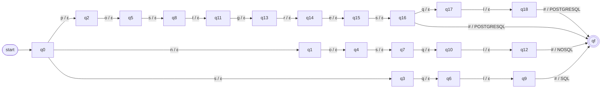
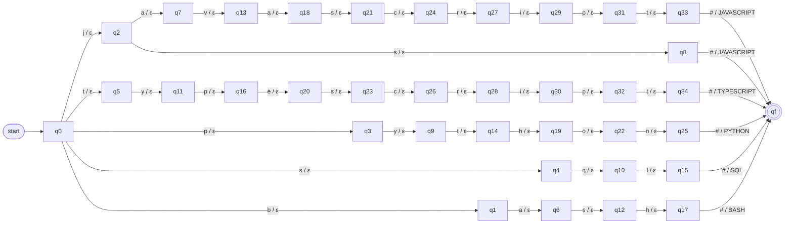
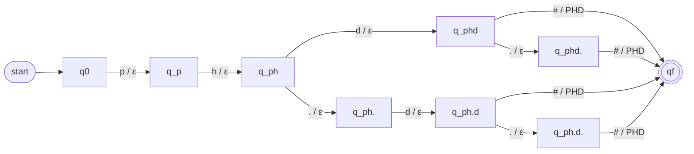
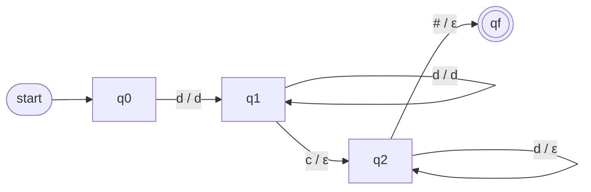

# ResumeLens – Finite-State Transducer Normalization Stage

## 1. Purpose of the Stage

The extraction stage (see `05_regex_design.md`) preserves every qualification exactly as it appears in the resume. As a consequence, the same qualification can arrive in several different forms:

```text
JS, Javascript, JavaScript
React, React.js, ReactJS
Postgres, PostgreSQL
```

The normalization stage receives these raw strings and transforms every equivalent variant into a single **canonical token**:

```text
JS          -> JAVASCRIPT
Javascript  -> JAVASCRIPT
React.js    -> REACT
ReactJS     -> REACT
NodeJS      -> NODE_JS
Postgres    -> POSTGRESQL
```

These transformations are modeled with **Finite-State Transducers (FST)** and implemented with `pyformlang`.

After normalization, the canonical tokens are **sorted according to the canonical order of each professional profile**, so that the next stage (finite automata) receives a sequence that does not depend on the order in which the candidate wrote the information.

```text
Extraction (regex)  ->  Normalization (FST)  ->  Sorting by profile  ->  Recognition (automata)
```

This stage does **not** decide whether the candidate satisfies a profile. It only transforms and organizes the information.

---

## 2. Requirements of the Stage

According to the project statement, for each transducer the team must:

- Provide the formal definition (complete 7-tuple): `M = (Q, Σ, Γ, δ, ω, q0, F)`.
- Clearly define the set of states `Q`, the input alphabet `Σ`, the output alphabet `Γ`, the transition relation `δ`, the output relation `ω`, the initial state `q0`, and the set of accepting states `F`.
- Provide a graphical representation of the transducers.
- Implement the transformations using `pyformlang`.
- Propose its own transformations (the ones in the statement are only examples).
- Prepare the normalized qualifications for the recognition stage, organizing them in the canonical order defined by each profile.

---

## 3. Design Decisions

### 3.1 One transducer per category

Instead of building one large transducer for the whole vocabulary, ResumeLens uses **one transducer per extraction category**:

| Transducer | Input (field of `ExtractedData`) |
| :--- | :--- |
| `M_LANG` | `programming_languages` |
| `M_FW` | `frameworks_libraries` |
| `M_DB` | `databases` |
| `M_TOOLS` | `tools_technologies` |
| `M_OTHER` | `other_qualifications` |
| `M_ACAD` | `academic_qualifications` |
| `M_EXP` | `professional_experience` |

Reasons:

- Each transducer is smaller, so it is easier to define formally, draw, and test.
- The categories of the extraction stage are preserved, which keeps the separation of responsibilities between stages.
- Adding a new variant only modifies the transducer of its category.

Contact information (emails and phone numbers) is **not normalized**, because it does not represent qualifications.

### 3.2 Character-level transducers

The transducers read the input **one character at a time**. Each transition reads exactly one symbol of `Σ`.

For example, the input `React.js` is read as:

```text
r, e, a, c, t, ., j, s
```

This makes the transducers real finite-state machines over an alphabet of characters, instead of a simple dictionary lookup of complete words.

### 3.3 Preprocessing before the transducer

Before entering a transducer, every extracted string is prepared with three simple operations:

1. Convert to lowercase: `React.js -> react.js`.
2. Replace the typographic apostrophe `’` with `'`: `Bachelor’s -> bachelor's`.
3. Remove spaces at the beginning and end, and replace any sequence of whitespace with a single space: `Spring   Boot -> spring boot`.

This decision reduces the size of the input alphabet `Σ` (only lowercase letters are needed) and the number of states, because the regex stage already accepted these variations (it uses `re.IGNORECASE` and `\s+`).

### 3.4 End-of-input marker `#`

Some variants are prefixes of other variants:

```text
react      -> REACT
react.js   -> REACT
machine learning                      -> MACHINE_LEARNING
machine learning model development    -> ML_MODEL_DEVELOPMENT
```

When the transducer finishes reading `react`, it cannot know yet whether the input ends there or continues with `.js`. To solve this, the special symbol `#` is appended at the end of every input:

```text
react.js  ->  r e a c t . j s #
```

The canonical token is produced **only when `#` is read**. This keeps every transducer deterministic: from each state, each input symbol has at most one transition.

### 3.5 Output alphabet made of canonical tokens

Each symbol of the output alphabet `Γ` is a complete canonical token (for example `REACT` or `NODE_JS`).

- Every transition that reads a normal character produces the empty string `ε`.
- The transition that reads `#` produces exactly one symbol of `Γ`: the canonical token.

Therefore, for every accepted input, the output is a string of length 1 over `Γ`.

The exception is `M_EXP` (Section 6.7), which copies digits to the output.

### 3.6 Inputs that are not recognized

If a string has no path from `q0` to the accepting state `qf`, the transducer **rejects** it and produces no output.

In theory this should not happen, because the vocabulary of each transducer is the same as the vocabulary of the corresponding regular expression. If it happens, the normalizer ignores the string and does not add any token.

### 3.7 Duplicates and `SQL`

- If the same qualification appears more than once in the resume (for example `JS` and `JavaScript`), both are transformed to `JAVASCRIPT`, and the normalizer keeps **only one** occurrence.
- `SQL` is extracted both as a programming language and as a database. Both `M_LANG` and `M_DB` transform it to the same token `SQL`, and the duplicate is removed. In this way, `SQL` appears only once in the final sequence.

---

## 4. Canonical Vocabulary

The tables show the input variants (after preprocessing) and their canonical token. These tables are the specification that the code must implement.

### 4.1 Programming languages — `M_LANG`

| Input variants | Canonical token |
| :--- | :--- |
| `javascript`, `js` | `JAVASCRIPT` |
| `typescript` | `TYPESCRIPT` |
| `python` | `PYTHON` |
| `sql` | `SQL` |
| `bash` | `BASH` |

### 4.2 Frameworks and libraries — `M_FW`

| Input variants | Canonical token |
| :--- | :--- |
| `react`, `react.js`, `reactjs` | `REACT` |
| `angular` | `ANGULAR` |
| `vue` | `VUE` |
| `node.js`, `nodejs` | `NODE_JS` |
| `django` | `DJANGO` |
| `spring boot` | `SPRING_BOOT` |
| `pandas` | `PANDAS` |
| `numpy` | `NUMPY` |
| `scikit-learn`, `scikit learn`, `scikitlearn`, `sklearn` | `SCIKIT_LEARN` |
| `tensorflow`, `tensor flow` | `TENSORFLOW` |
| `pytorch`, `py torch` | `PYTORCH` |
| `apache spark`, `spark` | `SPARK` |
| `apache airflow`, `airflow` | `AIRFLOW` |

`sklearn` is included because it is one of the examples of the project statement (`sklearn -> SCIKIT_LEARN`). See Section 12 about the extraction stage.

### 4.3 Databases — `M_DB`

| Input variants | Canonical token |
| :--- | :--- |
| `postgresql`, `postgres` | `POSTGRESQL` |
| `nosql` | `NOSQL` |
| `sql` | `SQL` |

### 4.4 Tools and technologies — `M_TOOLS`

| Input variants | Canonical token |
| :--- | :--- |
| `git` | `GIT` |
| `docker` | `DOCKER` |
| `kubernetes` | `KUBERNETES` |
| `nmap` | `NMAP` |
| `tcp/ip`, `tcp ip`, `tcp / ip`, `tcp /ip`, `tcp/ ip`, `tcpip` | `TCP_IP` |
| `networking`, `network` | `NETWORKING` |
| `etl` | `ETL` |
| `elt` | `ELT` |
| `data pipeline`, `data pipelines` | `DATA_PIPELINE` |
| `data warehouse`, `data warehousing` | `DATA_WAREHOUSING` |

### 4.5 Other qualifications — `M_OTHER`

| Input variants | Canonical token |
| :--- | :--- |
| `machine learning`, `machine-learning` | `MACHINE_LEARNING` |
| `machine learning model development`, `machine-learning model development` | `ML_MODEL_DEVELOPMENT` |
| `rest api`, `rest apis` | `REST_API` |
| `vulnerability assessment` | `VULNERABILITY_ASSESSMENT` |
| `cybersecurity`, `cyber security` | `CYBERSECURITY` |
| `security automation` | `SECURITY_AUTOMATION` |

### 4.6 Academic qualifications — `M_ACAD`

| Input variants | Canonical token |
| :--- | :--- |
| `bachelor`, `bachelor's`, `bsc`, `bsc.`, `b.sc`, `b.sc.` | `BACHELOR` |
| `master`, `master's`, `msc`, `msc.`, `m.sc`, `m.sc.` | `MASTER` |
| `phd`, `phd.`, `ph.d`, `ph.d.` | `PHD` |
| `computer science` | `COMPUTER_SCIENCE` |
| `software engineering` | `SOFTWARE_ENGINEERING` |
| `systems engineering` | `SYSTEMS_ENGINEERING` |
| `data science` | `DATA_SCIENCE` |

### 4.7 Professional experience — `M_EXP`

| Input example | Output |
| :--- | :--- |
| `3 years of experience` | `3` |
| `5+ yrs experience` | `5` |
| `2 yrs of experience` | `2` |

`M_EXP` keeps only the number of years. The value is stored as an integer (`experience_years`).

---

## 5. General Construction of the Dictionary Transducers

The transducers `M_LANG`, `M_FW`, `M_DB`, `M_TOOLS`, `M_OTHER`, and `M_ACAD` are built with the same method. Each one is a **prefix-tree transducer**: there is one state for every prefix of the input variants, so variants that start the same way share states (for example `react`, `react.js`, and `reactjs` share the states of `r`, `re`, `rea`, `reac`, `react`).

Let `V` be the set of input variants of the transducer and `T : V -> Γ` the table that assigns a canonical token to each variant (Section 4).

The formal definition is:

```text
M = (Q, Σ, Γ, δ, ω, q0, F)
```

where:

```text
Q   = { q_p | p is a prefix of some word of V }  ∪  { qf }
      (q_ε is the state of the empty prefix)

Σ   = { characters that appear in the words of V }  ∪  { # }

Γ   = { T(w) | w ∈ V }                       (the canonical tokens)

δ   : transition relation
      δ(q_p, a)  = q_pa     if pa is a prefix of some word of V
      δ(q_w, #)  = qf       if w ∈ V

ω   : output relation (output produced by each transition)
      ω(q_p, a)  = ε
      ω(q_w, #)  = T(w)

q0  = q_ε

F   = { qf }
```

Properties of this construction:

- **Deterministic:** for each state and each input symbol there is at most one transition.
- **Number of states:** `|Q| = (number of different prefixes of V, including ε) + 1`.
- **Number of transitions:** `(|Q| - 2) + |V|`, that is, one transition for each non-empty prefix plus one `#` transition for each variant.
- **Translation:** for every `w ∈ V`, the transducer translates `w#` into `T(w)`. Any other input is rejected.
- **Linear time:** a string of length `n` is translated with `n + 1` transitions.

In the code, the transducers are **generated automatically** from the tables of Section 4 (see Section 9), so the tables and the transducers cannot be different.

---

## 6. Transducers

### 6.1 Databases — `M_DB`

This transducer is presented completely as the reference example. The other dictionary transducers follow exactly the same construction.

```text
V = { postgresql, postgres, nosql, sql }
```

#### Formal definition

```text
M_DB = (Q, Σ, Γ, δ, ω, q0, F)

Q  = { q0, q1, ..., q18, qf }        (20 states)
Σ  = { e, g, l, n, o, p, q, r, s, t, # }
Γ  = { POSTGRESQL, NOSQL, SQL }
q0 = q0
F  = { qf }
```

Each state represents the prefix that has been read:

| State | Prefix read | State | Prefix read |
| :--- | :--- | :--- | :--- |
| `q0` | `ε` | `q10` | `nosq` |
| `q1` | `n` | `q11` | `post` |
| `q2` | `p` | `q12` | `nosql` |
| `q3` | `s` | `q13` | `postg` |
| `q4` | `no` | `q14` | `postgr` |
| `q5` | `po` | `q15` | `postgre` |
| `q6` | `sq` | `q16` | `postgres` |
| `q7` | `nos` | `q17` | `postgresq` |
| `q8` | `pos` | `q18` | `postgresql` |
| `q9` | `sql` | `qf` | accepting state |

#### Transition relation `δ` and output relation `ω`

| From | Input | To | Output |
| :--- | :--- | :--- | :--- |
| `q0` | `n` | `q1` | `ε` |
| `q0` | `p` | `q2` | `ε` |
| `q0` | `s` | `q3` | `ε` |
| `q1` | `o` | `q4` | `ε` |
| `q2` | `o` | `q5` | `ε` |
| `q3` | `q` | `q6` | `ε` |
| `q4` | `s` | `q7` | `ε` |
| `q5` | `s` | `q8` | `ε` |
| `q6` | `l` | `q9` | `ε` |
| `q7` | `q` | `q10` | `ε` |
| `q8` | `t` | `q11` | `ε` |
| `q10` | `l` | `q12` | `ε` |
| `q11` | `g` | `q13` | `ε` |
| `q13` | `r` | `q14` | `ε` |
| `q14` | `e` | `q15` | `ε` |
| `q15` | `s` | `q16` | `ε` |
| `q16` | `q` | `q17` | `ε` |
| `q17` | `l` | `q18` | `ε` |
| `q18` | `#` | `qf` | `POSTGRESQL` |
| `q16` | `#` | `qf` | `POSTGRESQL` |
| `q12` | `#` | `qf` | `NOSQL` |
| `q9` | `#` | `qf` | `SQL` |

Any pair (state, symbol) that does not appear in the table has no transition, so the input is rejected.

#### Graphical representation



#### Example of translation

Input extracted from the resume: `Postgres`.

```text
Preprocessing:  postgres
Input tape:     p o s t g r e s #
```

| Step | State | Reads | Next state | Writes |
| :--- | :--- | :--- | :--- | :--- |
| 1 | `q0` | `p` | `q2` | `ε` |
| 2 | `q2` | `o` | `q5` | `ε` |
| 3 | `q5` | `s` | `q8` | `ε` |
| 4 | `q8` | `t` | `q11` | `ε` |
| 5 | `q11` | `g` | `q13` | `ε` |
| 6 | `q13` | `r` | `q14` | `ε` |
| 7 | `q14` | `e` | `q15` | `ε` |
| 8 | `q15` | `s` | `q16` | `ε` |
| 9 | `q16` | `#` | `qf` | `POSTGRESQL` |

The transducer ends in `qf ∈ F`, so the input is accepted and the output is `POSTGRESQL`.

Example of rejection: `mysql` has no transition from `q0` with `m`, so it is rejected.

### 6.2 Programming languages — `M_LANG`

```text
V  = { javascript, js, typescript, python, sql, bash }
Σ  = { a, b, c, e, h, i, j, l, n, o, p, q, r, s, t, v, y, # }
Γ  = { JAVASCRIPT, TYPESCRIPT, PYTHON, SQL, BASH }
|Q| = 36  (35 prefixes + qf)
q0 = q_ε
F  = { qf }
δ, ω: defined by the construction of Section 5 with the table of Section 4.1.
```

Note that `javascript` and `js` share the state of the prefix `j`, and both end with the output `JAVASCRIPT`.



### 6.3 Frameworks and libraries — `M_FW`

```text
V  = the 23 variants of Section 4.2
Σ  = { space, -, ., a, b, c, d, e, f, g, h, i, j, k, l, m, n, o, p, r, s, t, u, v, w, y, # }
Γ  = { REACT, ANGULAR, VUE, NODE_JS, DJANGO, SPRING_BOOT, PANDAS, NUMPY,
       SCIKIT_LEARN, TENSORFLOW, PYTORCH, SPARK, AIRFLOW }
|Q| = 140
q0 = q_ε
F  = { qf }
δ, ω: defined by the construction of Section 5 with the table of Section 4.2.
```

Because the complete diagram has 140 states, the document shows the fragment of the `REACT` and `NODE_JS` variants. The complete diagram is generated from the code (Section 9.4).


The fragment shows the two main ideas of the design:

- `react`, `react.js`, and `reactjs` share the first five states.
- The output `REACT` is produced only when `#` is read, so `react` (state after `t`) and `react.js` can both be accepted without ambiguity.

### 6.4 Tools and technologies — `M_TOOLS`

```text
V  = the 18 variants of Section 4.4
Σ  = { space, /, a, b, c, d, e, g, h, i, k, l, m, n, o, p, r, s, t, u, w, # }
Γ  = { GIT, DOCKER, KUBERNETES, NMAP, TCP_IP, NETWORKING, ETL, ELT,
       DATA_PIPELINE, DATA_WAREHOUSING }
|Q| = 84
q0 = q_ε
F  = { qf }
δ, ω: defined by the construction of Section 5 with the table of Section 4.4.
```

Fragment for the `TCP_IP` variants:


(`␣` represents the space character.)

### 6.5 Other qualifications — `M_OTHER`

```text
V  = the 10 variants of Section 4.5
Σ  = { space, -, a, b, c, d, e, g, h, i, l, m, n, o, p, r, s, t, u, v, y, # }
Γ  = { MACHINE_LEARNING, ML_MODEL_DEVELOPMENT, REST_API,
       VULNERABILITY_ASSESSMENT, CYBERSECURITY, SECURITY_AUTOMATION }
|Q| = 137
q0 = q_ε
F  = { qf }
δ, ω: defined by the construction of Section 5 with the table of Section 4.5.
```

This transducer shows why the `#` marker is necessary: `machine learning` is a prefix of `machine learning model development`. In the state reached after `machine learning`:

- if the next symbol is `#`, the output is `MACHINE_LEARNING`;
- if the next symbol is a space, the transducer continues reading `model development`, and later produces `ML_MODEL_DEVELOPMENT`.

### 6.6 Academic qualifications — `M_ACAD`

```text
V  = the 20 variants of Section 4.6
Σ  = { space, ', ., a, b, c, d, e, f, g, h, i, l, m, n, o, p, r, s, t, u, w, y, # }
Γ  = { BACHELOR, MASTER, PHD, COMPUTER_SCIENCE, SOFTWARE_ENGINEERING,
       SYSTEMS_ENGINEERING, DATA_SCIENCE }
|Q| = 107
q0 = q_ε
F  = { qf }
δ, ω: defined by the construction of Section 5 with the table of Section 4.6.
```

Fragment for the `PHD` variants:



### 6.7 Professional experience — `M_EXP`

This transducer is different from the others. It does not map a complete word to a token; it **copies the digits** of the input to the output and **erases** the rest of the characters.

```text
M_EXP = (Q, Σ, Γ, δ, ω, q0, F)

Q  = { q0, q1, q2, qf }
Σ  = Digit ∪ Letter ∪ { +, space, # }
     Digit  = { 0, 1, ..., 9 }
     Letter = { a, b, ..., z }
Γ  = Digit
q0 = q0
F  = { qf }
```

Meaning of the states:

| State | Meaning |
| :--- | :--- |
| `q0` | Nothing has been read |
| `q1` | Reading the number of years |
| `q2` | Reading the rest of the expression (`+`, `years`, `of`, `experience`) |
| `qf` | End of input (accepting state) |

Transition relation `δ` and output relation `ω` (`d` represents any digit, `c` any symbol of `Σ` that is not a digit and not `#`):

| From | Input | To | Output |
| :--- | :--- | :--- | :--- |
| `q0` | `d` | `q1` | `d` |
| `q1` | `d` | `q1` | `d` |
| `q1` | `c` | `q2` | `ε` |
| `q2` | `c` | `q2` | `ε` |
| `q2` | `d` | `q2` | `ε` |
| `q2` | `#` | `qf` | `ε` |



Example:

```text
Input tape:   5 + ␣ y r s ␣ e x p e r i e n c e #
States:       q0 -5-> q1 -+-> q2 -...-> q2 -#-> qf
Output tape:  5
```

The output `5` is converted to the integer `5`. If the resume contains several experience expressions, the normalizer keeps the **maximum** value.

The regular expression of the extraction stage guarantees that every input of `M_EXP` starts with a number, so `M_EXP` only needs to separate the number from the rest of the expression.

### 6.8 Summary of the Transducers

| Transducer | Variants `|V|` | States `|Q|` | Transitions | Tokens `|Γ|` |
| :--- | :---: | :---: | :---: | :---: |
| `M_LANG` | 6 | 36 | 40 | 5 |
| `M_FW` | 23 | 140 | 161 | 13 |
| `M_DB` | 4 | 20 | 22 | 3 |
| `M_TOOLS` | 18 | 84 | 100 | 10 |
| `M_OTHER` | 10 | 137 | 145 | 6 |
| `M_ACAD` | 20 | 107 | 125 | 7 |
| `M_EXP` | — | 4 | 6 (by symbol class) | 10 (digits) |

These numbers must match the transducers generated by the code. They are a good unit test (Section 11).

---

## 7. Sorting by Profile (Canonical Order)

### 7.1 Purpose

The candidate can write the qualifications in any order:

```text
Git, NodeJS, JS, Postgres, React.js
```

To prevent the classification result from depending on this order, the normalized tokens are organized in a **canonical order defined by each profile** before they are sent to the automata.

This step is not a transducer; it is a sorting function that uses the order tables of this section.

### 7.2 Canonical order of each profile

Each profile is divided into **groups**. The groups are written in order, and inside each group the tokens follow the order shown.

#### Full Stack Developer

| Order | Group | Tokens |
| :---: | :--- | :--- |
| 1 | Frontend language | `JAVASCRIPT`, `TYPESCRIPT` |
| 2 | Frontend framework | `REACT`, `ANGULAR`, `VUE` |
| 3 | Backend | `NODE_JS`, `DJANGO`, `SPRING_BOOT` |
| 4 | API | `REST_API` |
| 5 | Database | `SQL`, `POSTGRESQL`, `NOSQL` |
| 6 | Version control | `GIT` |

#### Machine Learning Engineer

| Order | Group | Tokens |
| :---: | :--- | :--- |
| 1 | Language | `PYTHON` |
| 2 | Data libraries | `PANDAS`, `NUMPY` |
| 3 | ML libraries | `SCIKIT_LEARN`, `TENSORFLOW`, `PYTORCH` |
| 4 | ML development | `MACHINE_LEARNING`, `ML_MODEL_DEVELOPMENT` |
| 5 | Database | `SQL`, `POSTGRESQL` |
| 6 | Version control | `GIT` |

#### Cybersecurity Engineer

| Order | Group | Tokens |
| :---: | :--- | :--- |
| 1 | Scripting | `PYTHON`, `BASH` |
| 2 | Networking | `NETWORKING`, `TCP_IP` |
| 3 | Security | `CYBERSECURITY`, `NMAP`, `VULNERABILITY_ASSESSMENT`, `SECURITY_AUTOMATION` |
| 4 | Containers | `DOCKER`, `KUBERNETES` |
| 5 | Version control | `GIT` |

#### Data Engineer

| Order | Group | Tokens |
| :---: | :--- | :--- |
| 1 | Language | `PYTHON`, `SQL` |
| 2 | Processing | `SPARK` |
| 3 | Orchestration | `AIRFLOW` |
| 4 | Data integration | `ETL`, `ELT`, `DATA_PIPELINE` |
| 5 | Storage | `DATA_WAREHOUSING`, `POSTGRESQL`, `NOSQL` |
| 6 | Version control | `GIT` |

### 7.3 Sorting rules

1. Only the tokens that appear in the order table of the profile are kept for that profile. The other tokens are not relevant for that automaton and are discarded **only for that profile**.
2. The kept tokens are sorted by their position in the order table.
3. Each token appears at most once.
4. Academic qualifications and years of experience are not part of the sequence. They are kept in the normalized data for the candidate profile (DSL stage).

Since there are four profiles, the result of this step is **four sequences**, one for each automaton.

### 7.4 Example

```text
Normalized tokens (resume order):
GIT, NODE_JS, JAVASCRIPT, POSTGRESQL, REACT

Sequence for Full Stack Developer:
JAVASCRIPT, REACT, NODE_JS, POSTGRESQL, GIT

Sequence for Machine Learning Engineer:
POSTGRESQL, GIT

Sequence for Cybersecurity Engineer:
GIT

Sequence for Data Engineer:
POSTGRESQL, GIT
```

The Full Stack sequence is exactly the one expected by the project statement.

---

## 8. Output Data Structure

The result of the stage is stored in a new data structure, similar to `ExtractedData`:

```python
@dataclass
class NormalizedData:
    programming_languages: list[str]
    frameworks_libraries: list[str]
    databases: list[str]
    tools_technologies: list[str]
    other_qualifications: list[str]
    academic_qualifications: list[str]
    experience_years: int | None

    # All qualification tokens without duplicates, in the order they were found
    qualifications: list[str]

    # One sorted sequence per profile (input of the automata)
    profile_sequences: dict[str, list[str]]
```

Example for Wednesday Addams:

```text
programming_languages   = [JAVASCRIPT]
frameworks_libraries    = [REACT, NODE_JS]
databases               = [POSTGRESQL]
tools_technologies      = [GIT]
other_qualifications    = []
academic_qualifications = []
experience_years        = 3
qualifications          = [JAVASCRIPT, REACT, NODE_JS, POSTGRESQL, GIT]
profile_sequences       = {
    FULL_STACK_DEVELOPER:      [JAVASCRIPT, REACT, NODE_JS, POSTGRESQL, GIT],
    MACHINE_LEARNING_ENGINEER: [POSTGRESQL, GIT],
    CYBERSECURITY_ENGINEER:    [GIT],
    DATA_ENGINEER:             [POSTGRESQL, GIT],
}
```

---

## 9. Implementation Guide

### 9.1 File structure

Following the structure of the extraction stage:

```text
src/model/normalization/
    __init__.py
    canonical_vocabulary.py     # Tables of Section 4 (variant -> token)
    fst_builder.py              # Builds the transducers with pyformlang
    profile_order.py            # Order tables of Section 7
    normalized_data.py          # NormalizedData dataclass
    resume_normalizer.py        # Main entry point of the stage

tests/normalization/
    __init__.py
    test_fst_builder.py
    test_profile_order.py
    test_resume_normalizer.py
```

### 9.2 `canonical_vocabulary.py`

Only defines the tables of Section 4 as dictionaries. It does not build transducers.

```python
LANGUAGES_VOCABULARY = {
    "javascript": "JAVASCRIPT",
    "js": "JAVASCRIPT",
    "typescript": "TYPESCRIPT",
    "python": "PYTHON",
    "sql": "SQL",
    "bash": "BASH",
}

DATABASES_VOCABULARY = {
    "postgresql": "POSTGRESQL",
    "postgres": "POSTGRESQL",
    "nosql": "NOSQL",
    "sql": "SQL",
}

# FRAMEWORKS_VOCABULARY, TOOLS_VOCABULARY, OTHER_VOCABULARY,
# ACADEMIC_VOCABULARY follow the same format.
```

### 9.3 `fst_builder.py`

Builds each dictionary transducer from its table using the construction of Section 5.

```python
from pyformlang.fst import FST

END_MARKER = "#"
INITIAL_STATE = "q0"
FINAL_STATE = "qf"


def build_dictionary_fst(vocabulary: dict[str, str]) -> FST:
    """
    Build a prefix-tree transducer.
    Each character produces ε; the end marker produces the canonical token.
    """
    fst = FST()
    fst.add_start_state(INITIAL_STATE)
    fst.add_final_state(FINAL_STATE)

    state_of_prefix = {"": INITIAL_STATE}

    for variant, token in vocabulary.items():
        prefix = ""
        for char in variant:
            next_prefix = prefix + char
            if next_prefix not in state_of_prefix:
                state_of_prefix[next_prefix] = f"q{len(state_of_prefix)}"
                fst.add_transition(
                    state_of_prefix[prefix], char,
                    state_of_prefix[next_prefix], []      # output ε
                )
            prefix = next_prefix

        fst.add_transition(
            state_of_prefix[prefix], END_MARKER,
            FINAL_STATE, [token]                          # output token
        )

    return fst
```

`build_experience_fst()` builds `M_EXP` with the four states and transitions of Section 6.7, adding one transition for each digit and each non-digit symbol of `Σ`.

### 9.4 Translation with pyformlang

```python
def preprocess(text: str) -> str:
    text = text.lower().replace("’", "'")
    return " ".join(text.split())


def translate(fst: FST, text: str) -> str | None:
    input_word = list(preprocess(text)) + [END_MARKER]
    outputs = list(fst.translate(input_word))
    if not outputs:
        return None              # rejected input
    return "".join(outputs[0])
```

Notes for the implementation:

- In `pyformlang`, `add_transition(s_from, input_symbol, s_to, output_symbols)` receives the output as a list of symbols; an empty list represents `ε`.
- `translate` returns the possible outputs. Since the transducers are deterministic, there is at most one.
- Check the exact behavior of `translate` in the installed version of `pyformlang` (for example, the `max_length` parameter) with a first small test.
- The graphical representation of each transducer can be generated from the code (for example, exporting the transducer to `networkx` / DOT), so the diagrams always match the implementation.

### 9.5 `profile_order.py`

```python
FULL_STACK_ORDER = [
    "JAVASCRIPT", "TYPESCRIPT",
    "REACT", "ANGULAR", "VUE",
    "NODE_JS", "DJANGO", "SPRING_BOOT",
    "REST_API",
    "SQL", "POSTGRESQL", "NOSQL",
    "GIT",
]

# MACHINE_LEARNING_ORDER, CYBERSECURITY_ORDER, DATA_ENGINEER_ORDER ...

PROFILE_ORDERS = {
    "FULL_STACK_DEVELOPER": FULL_STACK_ORDER,
    # ...
}


def sort_for_profile(tokens: list[str], profile: str) -> list[str]:
    order = PROFILE_ORDERS[profile]
    kept = {token for token in tokens if token in order}
    return sorted(kept, key=order.index)
```

### 9.6 `resume_normalizer.py`

Main entry point of the stage:

```python
def normalize_resume(extracted: ExtractedData) -> NormalizedData:
    ...
```

Steps:

1. Translate each list of `ExtractedData` with the transducer of its category.
2. Remove rejected inputs (`None`) and duplicates, keeping the first appearance.
3. Translate `professional_experience` with `M_EXP` and keep the maximum.
4. Build `qualifications` joining the technical categories without duplicates.
5. Build `profile_sequences` with `sort_for_profile` for each profile.

---

## 10. Example of the Complete Normalization Process

### 10.1 Full Stack Developer

```text
Extracted (ExtractedData)
    programming_languages   = [JS]
    frameworks_libraries    = [React.js, NodeJS]
    databases               = [Postgres]
    tools_technologies      = [Git]
    professional_experience = [3 years of experience]

Normalization (FST)
    JS                      -> JAVASCRIPT
    React.js                -> REACT
    NodeJS                  -> NODE_JS
    Postgres                -> POSTGRESQL
    Git                     -> GIT
    3 years of experience   -> 3

Sequence for FULL_STACK_DEVELOPER
    JAVASCRIPT, REACT, NODE_JS, POSTGRESQL, GIT
```

### 10.2 Machine Learning Engineer

```text
Extracted
    Python, Pandas, NumPy, Scikit-learn, TensorFlow, SQL, Git

Normalization (FST)
    Python        -> PYTHON
    Pandas        -> PANDAS
    NumPy         -> NUMPY
    Scikit-learn  -> SCIKIT_LEARN
    TensorFlow    -> TENSORFLOW
    SQL           -> SQL           (extracted twice: language and database; kept once)
    Git           -> GIT

Sequence for MACHINE_LEARNING_ENGINEER
    PYTHON, PANDAS, NUMPY, SCIKIT_LEARN, TENSORFLOW, SQL, GIT
```

---

## 11. Test Cases for this Stage

| Test | Input | Expected result |
| :--- | :--- | :--- |
| Variant to token | `JS` | `JAVASCRIPT` |
| Case and spaces | `  Tensor   Flow ` | `TENSORFLOW` |
| Prefix of another variant | `React` and `React.js` | `REACT` in both cases |
| Longer variant with shared prefix | `Machine Learning Model Development` | `ML_MODEL_DEVELOPMENT` |
| Typographic apostrophe | `Bachelor’s` | `BACHELOR` |
| Rejected input | `mysql` in `M_DB` | No output (`None`) |
| Experience | `5+ yrs experience` | `5` |
| Several experiences | `2 years of experience`, `4 years experience` | `experience_years = 4` |
| Duplicates | `JS`, `JavaScript` | Only one `JAVASCRIPT` |
| SQL in two categories | `SQL` as language and database | Only one `SQL` |
| Canonical order | `Git, NodeJS, JS, Postgres, React.js` | `JAVASCRIPT, REACT, NODE_JS, POSTGRESQL, GIT` |
| Tokens of other profile | `PANDAS` in Full Stack | Discarded for Full Stack |
| Size of the transducers | Build each FST | `|Q|` and transitions of Section 6.8 |

---

## 12. Observations for the Extraction Stage

While designing the vocabulary, the following differences with the current extraction stage were found. They do not change the design of the transducers, but they affect which strings arrive at this stage:

- `sklearn` is included in `M_FW` because it is an example of the statement, but the current regular expression does not extract it. Until the regex includes it, this variant will never reach the transducer.
- The Cybersecurity profile lists `Linux`, but it is not in the vocabulary of the extraction stage. If it is added to the regex, the token `LINUX` must be added to `M_TOOLS` and to the Cybersecurity order (Section 7.2).
- `Vue.js` is extracted as `Vue`, so it is normalized correctly to `VUE`.

---

## 13. Design Principles

- **One responsibility:** this stage only transforms and organizes; it does not classify.
- **Determinism:** every transducer is deterministic and produces at most one output for each input.
- **Single source of truth:** the tables of Section 4 are used to generate the transducers automatically, so the document, the vocabulary, and the code stay consistent.
- **Independence of the order:** the sorting by profile guarantees that two resumes with the same qualifications in different order produce the same sequence.
