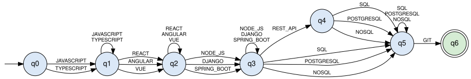
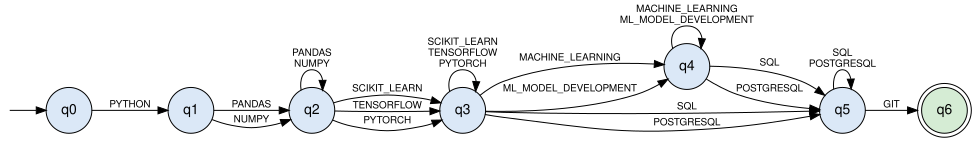
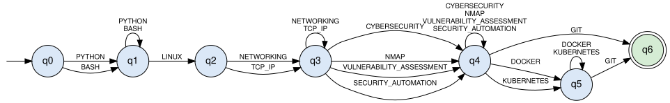
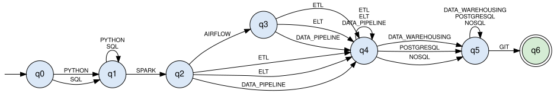

# ResumeLens – Finite Automata Qualification Pattern Recognition Stage

## 1. Purpose of the Stage

The normalization stage (`06_fst_design.md`) produces, for every profile, a **sorted sequence of canonical tokens**:

```text
PYTHON, PANDAS, TENSORFLOW, POSTGRESQL, GIT
```

This stage decides, for each of the four profiles, whether that sequence satisfies an **accepted qualification pattern** of the profile. Each profile has one finite automaton; the sequence is **ACCEPTED** if the automaton ends in an accepting state, and **REJECTED** otherwise.

```text
Extraction (regex) -> Normalization (FST) -> Sorting by profile -> Recognition (automata) -> ACCEPTED / REJECTED
```

A résumé can be accepted by several profiles, by one, or by none. This stage does not rank candidates and does not make hiring decisions.

### 1.1 Requirements of the Stage

| Requirement of the statement | Where |
| :--- | :--- |
| Complete 5-tuple `M = (Q, Σ, δ, q0, F)` of each automaton | Section 5, *Formal definition* and *Transition function δ* of each automaton |
| Type of automaton (DFA, NFA, or ε-NFA), justified with the definition | Section 3.6 and *Type of automaton* of each automaton |
| Transition diagram | Section 5, *Transition diagram* (`diagrams/automata/*.svg`) |
| Explanation of the profile pattern | Section 5, *Profile pattern* of each automaton |
| Implementation with `pyformlang` | `src/model/classification/profile_automata.py` (Section 6) |
| Classification of a résumé among the four profiles | `ProfileAutomata.classify` (Section 6) |

---

## 2. Input and Output of the Stage (Connection with Stage 2)

### 2.1 Input

The input is the `NormalizedData` object produced by `ResumeNormalizer.normalize` (stage 2). Each automaton reads the sequence of its own profile:

```python
normalized.profile_sequences[profile]
```

These sequences are already:

- **normalized** (`JS` → `JAVASCRIPT`, `Postgres` → `POSTGRESQL`, ...),
- **filtered** (only the tokens of that profile are kept),
- **sorted** in the canonical order of the profile (the groups of `ProfileVocabulary`),
- **without duplicates**.

Example (Wednesday Addams, from the statement):

```text
Résumé:                JS, React.js, NodeJS, Postgres, Git
FULL_STACK_DEVELOPER:  JAVASCRIPT, REACT, NODE_JS, POSTGRESQL, GIT
```

### 2.2 Output

A dictionary with the result of each profile:

```python
{
    "FULL_STACK_DEVELOPER": "ACCEPTED",
    "MACHINE_LEARNING_ENGINEER": "REJECTED",
    "CYBERSECURITY_ENGINEER": "REJECTED",
    "DATA_ENGINEER": "REJECTED",
}
```

This result is the input of stage 4 (candidate profile DSL), which must represent the result of the classification for each accepted profile.

### 2.3 The groups are defined only once

The automata expect the tokens in the order of the groups of the profile. The groups are defined **only once**, in `ProfileVocabulary.GROUPS`: stage 2 (`ResumeNormalizer.sort_for_profile`) uses them to sort the tokens, and the automata use the same lists to build their transitions. Therefore the two stages cannot become inconsistent. A unit test also checks that every sorted sequence follows the order of the groups (Section 7).

---

## 3. Design Decisions

### 3.1 One automaton per profile, all with the same structure

The four automata have the same shape: **7 states** (`q0` to `q6`), one state for each group of the profile, as in the example of the project statement:

```text
q0 --group 1--> q1 --group 2--> q2 --group 3--> q3 --group 4--> q4 --group 5--> q5 --group 6--> q6
```

Only the tokens of the groups change from one profile to another. This makes the four automata easy to compare, draw, and explain.

### 3.2 The alphabet is made of canonical tokens

Each symbol of `Σ` is a **complete token** (`PYTHON`, `REACT`, `GIT`), not a character. The automaton reads one token per transition. The variants (`JS`, `Javascript`, ...) never reach this stage, because stage 2 already transformed them.

### 3.3 One state per group

Each group contains equivalent alternatives (for example, `SCIKIT_LEARN`, `TENSORFLOW`, or `PYTORCH`). Every token of the group has its own transition from the previous state to the state of the group, exactly as in the diagram of the statement (`q2 --SCIKIT_LEARN / TENSORFLOW / PYTORCH--> q3`).

The meaning of a state `qi` is: *the candidate has at least one token of group i (and all the previous mandatory groups)*.

### 3.4 Loops: several tokens of the same group

Stage 2 keeps **all** the tokens of a group. For example, the Machine Learning example of the statement (Mary Jane Watson) produces:

```text
PYTHON, PANDAS, NUMPY, SCIKIT_LEARN, TENSORFLOW, SQL, GIT
```

It has two data libraries and two ML libraries. Without loops, the automaton would read `PANDAS` (q1 → q2) and then would have no transition with `NUMPY`, so the statement's own example would be rejected. For this reason, every group with more than one token has a **loop** on its state:

```text
q2 --PANDAS | NUMPY--> q2
```

This is the only difference with the diagram of the statement, and it is needed to accept the examples of the statement.

### 3.5 Optional groups: a transition that skips the state

Some groups are not required (for example, `REST_API` in Full Stack). An optional group adds transitions that **skip** its state: from the previous state, the tokens of the next group go directly to the following state.

```text
q3 --REST_API--> q4 --SQL--> q5      (with API)
q3 --SQL--> q5                       (without API)
```

| Profile | Optional group |
| :--- | :--- |
| Full Stack Developer | API (`REST_API`) |
| Machine Learning Engineer | ML development (`MACHINE_LEARNING`, `ML_MODEL_DEVELOPMENT`) |
| Cybersecurity Engineer | Containers (`DOCKER`, `KUBERNETES`) |
| Data Engineer | Orchestration (`AIRFLOW`) |

### 3.6 Type of automaton: DFA with a partial transition function

The four automata are **deterministic finite automata (DFA)**:

1. There is only **one initial state** (`q0`).
2. There are **no ε-transitions**: every transition reads one token. (The optional groups are solved with skip transitions, not with ε.)
3. From every state, each token has **at most one** next state. The tokens of a group are different from the tokens of the next group, so the loops, the normal transitions, and the skip transitions of a state never share a token.

δ is a **partial** function: if a pair (state, token) has no transition (for example, a token in the wrong order, or a token of another profile), the automaton goes to an implicit **trap state** that is not accepting, so the sequence is rejected. The trap state is not drawn, to keep the diagrams readable.

---

## 4. Profile Patterns

Each profile is defined by **6 ordered groups** (`src/model/classification/profile_vocabulary.py`). A sequence satisfies the pattern if it contains:

- at least one token of every **mandatory** group,
- zero or more tokens of the **optional** group,
- the tokens in the canonical order of the groups (guaranteed by stage 2).

The four profiles end with the group *Version control* (`GIT`), and every automaton has the accepting state `q6`, reached only after reading `GIT`.

---

## 5. Automata

### 5.1 Full Stack Developer — `A_FS`

#### Profile pattern

A candidate satisfies the Full Stack Developer pattern if the résumé shows the complete stack of a web application: at least one frontend language, one frontend framework, one backend technology, one database, and Git. REST APIs are valued but not required, because many résumés do not mention them explicitly.

| Order | Group | Tokens | Required |
| :---: | :--- | :--- | :---: |
| 1 | Frontend language | `JAVASCRIPT`, `TYPESCRIPT` | mandatory |
| 2 | Frontend framework | `REACT`, `ANGULAR`, `VUE` | mandatory |
| 3 | Backend | `NODE_JS`, `DJANGO`, `SPRING_BOOT` | mandatory |
| 4 | API | `REST_API` | optional |
| 5 | Database | `SQL`, `POSTGRESQL`, `NOSQL` | mandatory |
| 6 | Version control | `GIT` | mandatory |

Language recognized (regular expression over tokens, `⁺` = one or more, `*` = zero or more, `?` = optional):

```text
L(A_FS) = (JAVASCRIPT | TYPESCRIPT)⁺ · (REACT | ANGULAR | VUE)⁺ · (NODE_JS | DJANGO | SPRING_BOOT)⁺ · (REST_API)? · (SQL | POSTGRESQL | NOSQL)⁺ · GIT
```

#### Formal definition

```text
A_FS = (Q, Σ, δ, q0, F)

Q  = { q0, q1, q2, q3, q4, q5, q6 }
Σ  = { JAVASCRIPT, TYPESCRIPT, REACT, ANGULAR, VUE, NODE_JS, DJANGO, SPRING_BOOT, REST_API, SQL, POSTGRESQL, NOSQL, GIT }
     |Σ| = 13
δ  : Q × Σ → Q   (partial function, 27 transitions, table below)
q0 = q0
F  = { q6 }
```

| State | Meaning |
| :--- | :--- |
| `q0` | Initial state: nothing has been read |
| `q1` | At least one token of the group *Frontend language* has been read |
| `q2` | At least one token of the group *Frontend framework* has been read |
| `q3` | At least one token of the group *Backend* has been read |
| `q4` | At least one token of the group *API* has been read |
| `q5` | At least one token of the group *Database* has been read |
| `q6` | At least one token of the group *Version control* has been read (accepting state) |

**Transition function δ.** Each row represents one transition for each token of the column *Tokens*.

| From | Tokens | To | Meaning |
| :--- | :--- | :--- | :--- |
| `q0` | `JAVASCRIPT` \| `TYPESCRIPT` | `q1` | group 1 (Frontend language) |
| `q1` | `JAVASCRIPT` \| `TYPESCRIPT` | `q1` | loop: more tokens of the same group |
| `q1` | `REACT` \| `ANGULAR` \| `VUE` | `q2` | group 2 (Frontend framework) |
| `q2` | `REACT` \| `ANGULAR` \| `VUE` | `q2` | loop: more tokens of the same group |
| `q2` | `NODE_JS` \| `DJANGO` \| `SPRING_BOOT` | `q3` | group 3 (Backend) |
| `q3` | `NODE_JS` \| `DJANGO` \| `SPRING_BOOT` | `q3` | loop: more tokens of the same group |
| `q3` | `REST_API` | `q4` | group 4 (API) |
| `q4` | `SQL` \| `POSTGRESQL` \| `NOSQL` | `q5` | group 5 (Database) |
| `q3` | `SQL` \| `POSTGRESQL` \| `NOSQL` | `q5` | skips the optional group 4 (API) |
| `q5` | `SQL` \| `POSTGRESQL` \| `NOSQL` | `q5` | loop: more tokens of the same group |
| `q5` | `GIT` | `q6` | group 6 (Version control) |

Any pair (state, token) that is not in the table has no transition: the automaton stops and the sequence is **rejected**.

#### Type of automaton

`A_FS` is a **DFA (deterministic finite automaton)**: it has only one initial state (`q0`); every transition reads exactly one token, so there are no ε-transitions; and from each state each token has **at most one** next state. For example, from `q3` the tokens of the optional group and the tokens that skip it are different, so there is never a choice between two states. δ is a partial function: the missing transitions go to an implicit trap state (Section 3.6).

#### Transition diagram



File: `diagrams/automata/a_fs.svg` (source: `diagrams/automata/a_fs.dot`).

#### Examples

| Case | Sequence (from stage 2) | Run | Output |
| :--- | :--- | :--- | :---: |
| Wednesday Addams (statement) | `JAVASCRIPT, REACT, NODE_JS, POSTGRESQL, GIT` | `q0 --JAVASCRIPT--> q1 --REACT--> q2 --NODE_JS--> q3 --POSTGRESQL--> q5 --GIT--> q6` | **ACCEPTED** |
| With the optional API and two languages | `JAVASCRIPT, TYPESCRIPT, ANGULAR, SPRING_BOOT, REST_API, SQL, GIT` | `q0 --JAVASCRIPT--> q1 --TYPESCRIPT--> q1 --ANGULAR--> q2 --SPRING_BOOT--> q3 --REST_API--> q4 --SQL--> q5 --GIT--> q6` | **ACCEPTED** |
| Without backend | `JAVASCRIPT, REACT, POSTGRESQL, GIT` | `q0 --JAVASCRIPT--> q1 --REACT--> q2 --POSTGRESQL--> (no transition)` | **REJECTED** |
| Without Git | `TYPESCRIPT, VUE, DJANGO, NOSQL` | `q0 --TYPESCRIPT--> q1 --VUE--> q2 --DJANGO--> q3 --NOSQL--> q5 (ends in q5 ∉ F)` | **REJECTED** |


### 5.2 Machine Learning Engineer — `A_ML`

#### Profile pattern

A candidate satisfies the Machine Learning Engineer pattern if the résumé shows Python, at least one data library (Pandas or NumPy), at least one machine-learning library (Scikit-learn, TensorFlow, or PyTorch), SQL or PostgreSQL, and Git. Mentioning machine-learning model development explicitly is optional, because the ML libraries already show it. This is the automaton of the example of the project statement.

| Order | Group | Tokens | Required |
| :---: | :--- | :--- | :---: |
| 1 | Language | `PYTHON` | mandatory |
| 2 | Data libraries | `PANDAS`, `NUMPY` | mandatory |
| 3 | ML libraries | `SCIKIT_LEARN`, `TENSORFLOW`, `PYTORCH` | mandatory |
| 4 | ML development | `MACHINE_LEARNING`, `ML_MODEL_DEVELOPMENT` | optional |
| 5 | Database | `SQL`, `POSTGRESQL` | mandatory |
| 6 | Version control | `GIT` | mandatory |

Language recognized (regular expression over tokens, `⁺` = one or more, `*` = zero or more, `?` = optional):

```text
L(A_ML) = PYTHON · (PANDAS | NUMPY)⁺ · (SCIKIT_LEARN | TENSORFLOW | PYTORCH)⁺ · (MACHINE_LEARNING | ML_MODEL_DEVELOPMENT)* · (SQL | POSTGRESQL)⁺ · GIT
```

#### Formal definition

```text
A_ML = (Q, Σ, δ, q0, F)

Q  = { q0, q1, q2, q3, q4, q5, q6 }
Σ  = { PYTHON, PANDAS, NUMPY, SCIKIT_LEARN, TENSORFLOW, PYTORCH, MACHINE_LEARNING, ML_MODEL_DEVELOPMENT, SQL, POSTGRESQL, GIT }
     |Σ| = 11
δ  : Q × Σ → Q   (partial function, 22 transitions, table below)
q0 = q0
F  = { q6 }
```

| State | Meaning |
| :--- | :--- |
| `q0` | Initial state: nothing has been read |
| `q1` | At least one token of the group *Language* has been read |
| `q2` | At least one token of the group *Data libraries* has been read |
| `q3` | At least one token of the group *ML libraries* has been read |
| `q4` | At least one token of the group *ML development* has been read |
| `q5` | At least one token of the group *Database* has been read |
| `q6` | At least one token of the group *Version control* has been read (accepting state) |

**Transition function δ.** Each row represents one transition for each token of the column *Tokens*.

| From | Tokens | To | Meaning |
| :--- | :--- | :--- | :--- |
| `q0` | `PYTHON` | `q1` | group 1 (Language) |
| `q1` | `PANDAS` \| `NUMPY` | `q2` | group 2 (Data libraries) |
| `q2` | `PANDAS` \| `NUMPY` | `q2` | loop: more tokens of the same group |
| `q2` | `SCIKIT_LEARN` \| `TENSORFLOW` \| `PYTORCH` | `q3` | group 3 (ML libraries) |
| `q3` | `SCIKIT_LEARN` \| `TENSORFLOW` \| `PYTORCH` | `q3` | loop: more tokens of the same group |
| `q3` | `MACHINE_LEARNING` \| `ML_MODEL_DEVELOPMENT` | `q4` | group 4 (ML development) |
| `q4` | `MACHINE_LEARNING` \| `ML_MODEL_DEVELOPMENT` | `q4` | loop: more tokens of the same group |
| `q4` | `SQL` \| `POSTGRESQL` | `q5` | group 5 (Database) |
| `q3` | `SQL` \| `POSTGRESQL` | `q5` | skips the optional group 4 (ML development) |
| `q5` | `SQL` \| `POSTGRESQL` | `q5` | loop: more tokens of the same group |
| `q5` | `GIT` | `q6` | group 6 (Version control) |

Any pair (state, token) that is not in the table has no transition: the automaton stops and the sequence is **rejected**.

#### Type of automaton

`A_ML` is a **DFA (deterministic finite automaton)**: it has only one initial state (`q0`); every transition reads exactly one token, so there are no ε-transitions; and from each state each token has **at most one** next state. For example, from `q3` the tokens of the optional group and the tokens that skip it are different, so there is never a choice between two states. δ is a partial function: the missing transitions go to an implicit trap state (Section 3.6).

#### Transition diagram



File: `diagrams/automata/a_ml.svg` (source: `diagrams/automata/a_ml.dot`).

#### Examples

| Case | Sequence (from stage 2) | Run | Output |
| :--- | :--- | :--- | :---: |
| Example of the statement (guide) | `PYTHON, PANDAS, TENSORFLOW, POSTGRESQL, GIT` | `q0 --PYTHON--> q1 --PANDAS--> q2 --TENSORFLOW--> q3 --POSTGRESQL--> q5 --GIT--> q6` | **ACCEPTED** |
| Mary Jane Watson (statement) | `PYTHON, PANDAS, NUMPY, SCIKIT_LEARN, TENSORFLOW, SQL, GIT` | `q0 --PYTHON--> q1 --PANDAS--> q2 --NUMPY--> q2 --SCIKIT_LEARN--> q3 --TENSORFLOW--> q3 --SQL--> q5 --GIT--> q6` | **ACCEPTED** |
| Without ML library | `PYTHON, PANDAS, SQL, GIT` | `q0 --PYTHON--> q1 --PANDAS--> q2 --SQL--> (no transition)` | **REJECTED** |
| Without Python | `NUMPY, PYTORCH, SQL, GIT` | `q0 --NUMPY--> (no transition)` | **REJECTED** |


### 5.3 Cybersecurity Engineer — `A_SEC`

#### Profile pattern

A candidate satisfies the Cybersecurity Engineer pattern if the résumé shows a scripting language (Python or Bash), Linux, networking knowledge (networking or TCP/IP), at least one security qualification or tool, and Git. Containers (Docker or Kubernetes) are optional.

| Order | Group | Tokens | Required |
| :---: | :--- | :--- | :---: |
| 1 | Scripting | `PYTHON`, `BASH` | mandatory |
| 2 | Operating system | `LINUX` | mandatory |
| 3 | Networking | `NETWORKING`, `TCP_IP` | mandatory |
| 4 | Security | `CYBERSECURITY`, `NMAP`, `VULNERABILITY_ASSESSMENT`, `SECURITY_AUTOMATION` | mandatory |
| 5 | Containers | `DOCKER`, `KUBERNETES` | optional |
| 6 | Version control | `GIT` | mandatory |

Language recognized (regular expression over tokens, `⁺` = one or more, `*` = zero or more, `?` = optional):

```text
L(A_SEC) = (PYTHON | BASH)⁺ · LINUX · (NETWORKING | TCP_IP)⁺ · (CYBERSECURITY | NMAP | VULNERABILITY_ASSESSMENT | SECURITY_AUTOMATION)⁺ · (DOCKER | KUBERNETES)* · GIT
```

#### Formal definition

```text
A_SEC = (Q, Σ, δ, q0, F)

Q  = { q0, q1, q2, q3, q4, q5, q6 }
Σ  = { PYTHON, BASH, LINUX, NETWORKING, TCP_IP, CYBERSECURITY, NMAP, VULNERABILITY_ASSESSMENT, SECURITY_AUTOMATION, DOCKER, KUBERNETES, GIT }
     |Σ| = 12
δ  : Q × Σ → Q   (partial function, 23 transitions, table below)
q0 = q0
F  = { q6 }
```

| State | Meaning |
| :--- | :--- |
| `q0` | Initial state: nothing has been read |
| `q1` | At least one token of the group *Scripting* has been read |
| `q2` | At least one token of the group *Operating system* has been read |
| `q3` | At least one token of the group *Networking* has been read |
| `q4` | At least one token of the group *Security* has been read |
| `q5` | At least one token of the group *Containers* has been read |
| `q6` | At least one token of the group *Version control* has been read (accepting state) |

**Transition function δ.** Each row represents one transition for each token of the column *Tokens*.

| From | Tokens | To | Meaning |
| :--- | :--- | :--- | :--- |
| `q0` | `PYTHON` \| `BASH` | `q1` | group 1 (Scripting) |
| `q1` | `PYTHON` \| `BASH` | `q1` | loop: more tokens of the same group |
| `q1` | `LINUX` | `q2` | group 2 (Operating system) |
| `q2` | `NETWORKING` \| `TCP_IP` | `q3` | group 3 (Networking) |
| `q3` | `NETWORKING` \| `TCP_IP` | `q3` | loop: more tokens of the same group |
| `q3` | `CYBERSECURITY` \| `NMAP` \| `VULNERABILITY_ASSESSMENT` \| `SECURITY_AUTOMATION` | `q4` | group 4 (Security) |
| `q4` | `CYBERSECURITY` \| `NMAP` \| `VULNERABILITY_ASSESSMENT` \| `SECURITY_AUTOMATION` | `q4` | loop: more tokens of the same group |
| `q4` | `DOCKER` \| `KUBERNETES` | `q5` | group 5 (Containers) |
| `q5` | `DOCKER` \| `KUBERNETES` | `q5` | loop: more tokens of the same group |
| `q5` | `GIT` | `q6` | group 6 (Version control) |
| `q4` | `GIT` | `q6` | skips the optional group 5 (Containers) |

Any pair (state, token) that is not in the table has no transition: the automaton stops and the sequence is **rejected**.

#### Type of automaton

`A_SEC` is a **DFA (deterministic finite automaton)**: it has only one initial state (`q0`); every transition reads exactly one token, so there are no ε-transitions; and from each state each token has **at most one** next state. For example, from `q4` the tokens of the optional group and the tokens that skip it are different, so there is never a choice between two states. δ is a partial function: the missing transitions go to an implicit trap state (Section 3.6).

#### Transition diagram



File: `diagrams/automata/a_sec.svg` (source: `diagrams/automata/a_sec.dot`).

#### Examples

| Case | Sequence (from stage 2) | Run | Output |
| :--- | :--- | :--- | :---: |
| Peter Parker (profile example) | `PYTHON, LINUX, TCP_IP, NMAP, DOCKER, GIT` | `q0 --PYTHON--> q1 --LINUX--> q2 --TCP_IP--> q3 --NMAP--> q4 --DOCKER--> q5 --GIT--> q6` | **ACCEPTED** |
| Without containers | `BASH, LINUX, NETWORKING, CYBERSECURITY, VULNERABILITY_ASSESSMENT, GIT` | `q0 --BASH--> q1 --LINUX--> q2 --NETWORKING--> q3 --CYBERSECURITY--> q4 --VULNERABILITY_ASSESSMENT--> q4 --GIT--> q6` | **ACCEPTED** |
| Without Linux | `PYTHON, TCP_IP, NMAP, GIT` | `q0 --PYTHON--> q1 --TCP_IP--> (no transition)` | **REJECTED** |
| Without security | `PYTHON, LINUX, NETWORKING, DOCKER, GIT` | `q0 --PYTHON--> q1 --LINUX--> q2 --NETWORKING--> q3 --DOCKER--> (no transition)` | **REJECTED** |


### 5.4 Data Engineer — `A_DE`

#### Profile pattern

A candidate satisfies the Data Engineer pattern if the résumé shows Python or SQL, Apache Spark, at least one data-integration qualification (ETL, ELT, or data pipelines), at least one storage technology, and Git. Apache Airflow is optional.

| Order | Group | Tokens | Required |
| :---: | :--- | :--- | :---: |
| 1 | Language | `PYTHON`, `SQL` | mandatory |
| 2 | Processing | `SPARK` | mandatory |
| 3 | Orchestration | `AIRFLOW` | optional |
| 4 | Data integration | `ETL`, `ELT`, `DATA_PIPELINE` | mandatory |
| 5 | Storage | `DATA_WAREHOUSING`, `POSTGRESQL`, `NOSQL` | mandatory |
| 6 | Version control | `GIT` | mandatory |

Language recognized (regular expression over tokens, `⁺` = one or more, `*` = zero or more, `?` = optional):

```text
L(A_DE) = (PYTHON | SQL)⁺ · SPARK · (AIRFLOW)? · (ETL | ELT | DATA_PIPELINE)⁺ · (DATA_WAREHOUSING | POSTGRESQL | NOSQL)⁺ · GIT
```

#### Formal definition

```text
A_DE = (Q, Σ, δ, q0, F)

Q  = { q0, q1, q2, q3, q4, q5, q6 }
Σ  = { PYTHON, SQL, SPARK, AIRFLOW, ETL, ELT, DATA_PIPELINE, DATA_WAREHOUSING, POSTGRESQL, NOSQL, GIT }
     |Σ| = 11
δ  : Q × Σ → Q   (partial function, 22 transitions, table below)
q0 = q0
F  = { q6 }
```

| State | Meaning |
| :--- | :--- |
| `q0` | Initial state: nothing has been read |
| `q1` | At least one token of the group *Language* has been read |
| `q2` | At least one token of the group *Processing* has been read |
| `q3` | At least one token of the group *Orchestration* has been read |
| `q4` | At least one token of the group *Data integration* has been read |
| `q5` | At least one token of the group *Storage* has been read |
| `q6` | At least one token of the group *Version control* has been read (accepting state) |

**Transition function δ.** Each row represents one transition for each token of the column *Tokens*.

| From | Tokens | To | Meaning |
| :--- | :--- | :--- | :--- |
| `q0` | `PYTHON` \| `SQL` | `q1` | group 1 (Language) |
| `q1` | `PYTHON` \| `SQL` | `q1` | loop: more tokens of the same group |
| `q1` | `SPARK` | `q2` | group 2 (Processing) |
| `q2` | `AIRFLOW` | `q3` | group 3 (Orchestration) |
| `q3` | `ETL` \| `ELT` \| `DATA_PIPELINE` | `q4` | group 4 (Data integration) |
| `q2` | `ETL` \| `ELT` \| `DATA_PIPELINE` | `q4` | skips the optional group 3 (Orchestration) |
| `q4` | `ETL` \| `ELT` \| `DATA_PIPELINE` | `q4` | loop: more tokens of the same group |
| `q4` | `DATA_WAREHOUSING` \| `POSTGRESQL` \| `NOSQL` | `q5` | group 5 (Storage) |
| `q5` | `DATA_WAREHOUSING` \| `POSTGRESQL` \| `NOSQL` | `q5` | loop: more tokens of the same group |
| `q5` | `GIT` | `q6` | group 6 (Version control) |

Any pair (state, token) that is not in the table has no transition: the automaton stops and the sequence is **rejected**.

#### Type of automaton

`A_DE` is a **DFA (deterministic finite automaton)**: it has only one initial state (`q0`); every transition reads exactly one token, so there are no ε-transitions; and from each state each token has **at most one** next state. For example, from `q2` the tokens of the optional group and the tokens that skip it are different, so there is never a choice between two states. δ is a partial function: the missing transitions go to an implicit trap state (Section 3.6).

#### Transition diagram



File: `diagrams/automata/a_de.svg` (source: `diagrams/automata/a_de.dot`).

#### Examples

| Case | Sequence (from stage 2) | Run | Output |
| :--- | :--- | :--- | :---: |
| Clark Kent (profile example) | `PYTHON, SQL, SPARK, AIRFLOW, ETL, POSTGRESQL, GIT` | `q0 --PYTHON--> q1 --SQL--> q1 --SPARK--> q2 --AIRFLOW--> q3 --ETL--> q4 --POSTGRESQL--> q5 --GIT--> q6` | **ACCEPTED** |
| Without Airflow | `SQL, SPARK, DATA_PIPELINE, DATA_WAREHOUSING, GIT` | `q0 --SQL--> q1 --SPARK--> q2 --DATA_PIPELINE--> q4 --DATA_WAREHOUSING--> q5 --GIT--> q6` | **ACCEPTED** |
| Without Spark | `PYTHON, ETL, POSTGRESQL, GIT` | `q0 --PYTHON--> q1 --ETL--> (no transition)` | **REJECTED** |
| Without storage | `PYTHON, SPARK, ELT, GIT` | `q0 --PYTHON--> q1 --SPARK--> q2 --ELT--> q4 --GIT--> (no transition)` | **REJECTED** |

---

## 6. Implementation

### 6.1 Files

```text
src/model/classification/
    __init__.py
    profile_vocabulary.py      # class ProfileVocabulary: tokens of each group of each profile
    profile_automata.py        # class ProfileAutomata: the four DFAs (pyformlang) and classify()

diagrams/automata/
    a_fs, a_ml, a_sec, a_de    # transition diagrams (.svg and Graphviz .dot)

tests/classification/
    test_profile_automata.py
```

### 6.2 `ProfileVocabulary`

It only defines data: one list per group, the list `GROUPS` with the 6 groups of each profile in order, and `OPTIONAL` with the optional group of each profile.

```python
class ProfileVocabulary:
    ML_LANGUAGE = ["PYTHON"]
    ML_DATA_LIBRARIES = ["PANDAS", "NUMPY"]
    ML_LIBRARIES = ["SCIKIT_LEARN", "TENSORFLOW", "PYTORCH"]
    ML_DEVELOPMENT = ["MACHINE_LEARNING", "ML_MODEL_DEVELOPMENT"]   # optional
    ML_DATABASE = ["SQL", "POSTGRESQL"]
    ML_VERSION_CONTROL = ["GIT"]
    ...
```

### 6.3 `ProfileAutomata`

Each automaton is written by hand with `pyformlang` (`DeterministicFiniteAutomaton`, `State`, `Symbol`), group by group. For example, `A_ML`:

```python
q0 = State("q0")
q1 = State("q1")    # language read
...
q6 = State("q6")    # version control read

dfa.add_start_state(q0)
dfa.add_final_state(q6)

# 1. Language: PYTHON
self._add(p, dfa, q0, V.ML_LANGUAGE, q1)

# 2. Data libraries: PANDAS | NUMPY
self._add(p, dfa, q1, V.ML_DATA_LIBRARIES, q2)
self._add(p, dfa, q2, V.ML_DATA_LIBRARIES, q2)        # loop
...
# 5. Database: SQL | POSTGRESQL
self._add(p, dfa, q4, V.ML_DATABASE, q5)
self._add(p, dfa, q3, V.ML_DATABASE, q5)              # skips ML development
self._add(p, dfa, q5, V.ML_DATABASE, q5)              # loop

# 6. Version control: GIT
self._add(p, dfa, q5, V.ML_VERSION_CONTROL, q6)
```

`_add(profile, dfa, source, tokens, target)` adds one transition `source --token--> target` for each token of the list (it is the same as writing one `add_transition` per token). It also saves the transition in `self.transitions`, which the tests use to check that every automaton is deterministic and has the documented size.

Main methods:

| Method | Description |
| :--- | :--- |
| `accepts(profile, sequence)` | Runs the automaton of the profile with `pyformlang` (`dfa.accepts`) and returns `True` or `False`. |
| `classify(normalized)` | Main entry point of the stage. Runs the four automata on `normalized.profile_sequences` and returns `{profile: "ACCEPTED" / "REJECTED"}`. |

Usage with stages 1 and 2:

```python
from src.model.extraction.resume_extractor import extract_resume_information
from src.model.normalization.resume_normalizer import ResumeNormalizer
from src.model.classification.profile_automata import ProfileAutomata

extracted = extract_resume_information(text)       # stage 1
normalized = ResumeNormalizer().normalize(extracted)   # stage 2
result = ProfileAutomata().classify(normalized)    # stage 3
```

### 6.4 Diagrams

The transition diagrams are in `diagrams/automata/` (`.svg`, and the Graphviz source `.dot`). The style follows the example of the statement: one arrow per token, the loops of a state drawn as one arrow with all their tokens, and a double circle for the accepting state `q6`. They were generated from the transitions of `ProfileAutomata`, so they match the implementation.

---

## 7. Test Cases for this Stage

`tests/classification/test_profile_automata.py`:

| Test | Input | Expected result |
| :--- | :--- | :--- |
| Order of stage 2 | `sort_for_profile` with all the tokens in reverse order | The sequence follows the order of the groups of `ProfileVocabulary` |
| Tokens produced by stage 2 | Every token of the automata | Exists in the canonical vocabulary of stage 2 |
| Example of the statement (Full Stack), stages 1-2-3 | `JS, React.js, NodeJS, Postgres, Git` | `FULL_STACK_DEVELOPER: ACCEPTED` |
| Example of the statement (ML), stages 1-2-3 | `Python, Pandas, NumPy, Scikit-learn, TensorFlow, SQL, Git` | `MACHINE_LEARNING_ENGINEER: ACCEPTED` |
| Example of the guide | `PYTHON, PANDAS, TENSORFLOW, POSTGRESQL, GIT` | `ACCEPTED` by `A_ML` |
| Order of the résumé | `Git, NodeJS, JS, Postgres, React.js` | `FULL_STACK_DEVELOPER: ACCEPTED` |
| Cybersecurity and Data Engineer examples | Profile examples of `04_profiles.md` | `ACCEPTED` |
| Several tokens of one group | `JAVASCRIPT, TYPESCRIPT, REACT, VUE, ...` | `ACCEPTED` (loops) |
| Optional group present or missing | With and without `REST_API`, `AIRFLOW`, containers | `ACCEPTED` in both cases |
| Mandatory group missing | Without backend, Git, Linux, or Spark | `REJECTED` |
| Wrong order or foreign token | `GIT` first; `REACT` in ML | `REJECTED` |
| Empty sequence | `[]` | `REJECTED` in the four automata |
| Four results | Empty résumé | One result per profile, all `REJECTED` |
| Determinism | Every automaton | No pair (state, token) has two transitions |
| Size | Every automaton | 7 states; 27, 22, 23, and 22 transitions |
