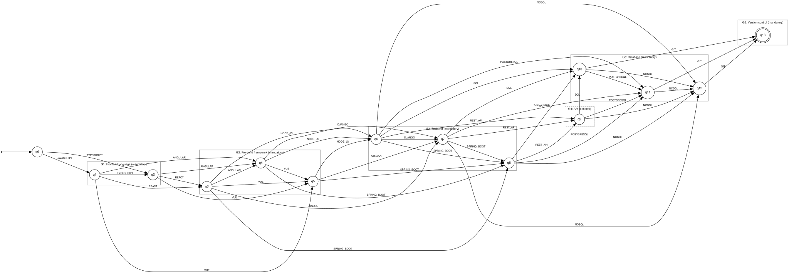
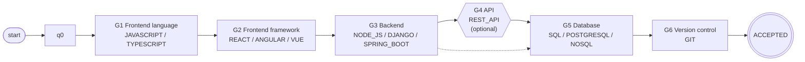

# ResumeLens – Finite Automata Qualification Pattern Recognition Stage

## 1. Purpose of the Stage

After the normalization stage, every résumé is represented by **four sorted sequences of canonical tokens**, one per professional profile (`NormalizedData.profile_sequences`). For example, the résumé of Wednesday Addams produces, for the Full Stack Developer profile:

```text
JAVASCRIPT, REACT, NODE_JS, POSTGRESQL, GIT
```

The purpose of this stage is to decide, with a formal and verifiable criterion, whether each sequence **belongs to the language of accepted qualification patterns** of its profile. For this purpose, ResumeLens defines one **finite automaton per profile**:

| Profile | Automaton |
| :--- | :--- |
| Full Stack Developer | `A_FS` |
| Machine Learning Engineer | `A_ML` |
| Cybersecurity Engineer | `A_SEC` |
| Data Engineer | `A_DE` |

The output of each automaton is binary:

```text
ACCEPTED  the sequence satisfies an accepted qualification pattern of the profile
REJECTED  the sequence does not satisfy it
```

A résumé can be accepted by several profiles, by only one, or by none. This stage **does not rank candidates** and does not make hiring decisions.

---

## 2. Input and Output of the Stage

### 2.1 Input

The input is the `NormalizedData` object produced by the normalization stage. The automata only use the field `profile_sequences`:

```text
profile_sequences = {
    FULL_STACK_DEVELOPER:      [JAVASCRIPT, REACT, NODE_JS, POSTGRESQL, GIT],
    MACHINE_LEARNING_ENGINEER: [POSTGRESQL, GIT],
    CYBERSECURITY_ENGINEER:    [GIT],
    DATA_ENGINEER:             [POSTGRESQL, GIT],
}
```

The sequences already satisfy the contract defined in `06_fst_design.md`, Section 7.3:

1. They contain only tokens of the profile.
2. The tokens follow the canonical order of the profile groups.
3. Each token appears at most once.

### 2.2 Output

For every profile, the stage produces a decision with:

- the sequence given to the automaton;
- the result `ACCEPTED` or `REJECTED`;
- the run of the automaton (sequence of states);
- for a rejection, the mandatory groups that are missing (only to explain the decision; the decision is always taken by the automaton).

---

## 3. Design Decisions

### 3.1 One automaton per profile, one common construction

The four automata are built by the **same construction method** (Section 5) from the definition of the groups of each profile. This satisfies the requirement that the four profiles are processed by the same general software solution, not by independent implementations. Adding a new profile only requires defining its groups and which of them are mandatory.

### 3.2 The alphabet is made of canonical tokens

The transducers of stage 2 read characters, because their task is to recognize spelling variants. The automata of stage 3 work at a **higher level of abstraction**: every input symbol is a complete canonical token.

```text
Σ(A_FS) = { JAVASCRIPT, TYPESCRIPT, REACT, ANGULAR, VUE, NODE_JS, DJANGO,
            SPRING_BOOT, REST_API, SQL, POSTGRESQL, NOSQL, GIT }
```

This choice is possible because the normalization stage already guarantees a finite and closed vocabulary. Working with tokens keeps the automata small (one state per token), readable, and directly related to the qualifications of the profile.

### 3.3 The input is sorted

Because the sequence is sorted by the canonical order of the profile, the automaton only has to move **forward** through the groups. The result does not depend on the order in which the candidate wrote the skills, and the automaton does not need to remember which groups were already seen in an arbitrary order (which would require one state per subset of groups).

### 3.4 Mandatory and optional groups

Each profile is divided into the groups defined in `profile_order.py`. Each group is marked as:

- **Mandatory (M):** the candidate must have **at least one** token of the group.
- **Optional (O):** the group can be missing; if it is present, it is accepted.

Inside a group, the candidate can have **one or more** tokens (for example `PANDAS` and `NUMPY`), always in the order of the group.

The optional groups were chosen so that the two résumé fragments of the project statement are accepted (for example, the Full Stack example does not mention `REST_API`, and the Machine Learning example of Stage 3 does not mention a model-development qualification), while the groups that identify the profile remain mandatory.

### 3.5 Type of automaton: DFA

The automata are **deterministic finite automata (DFA)**. The definition (Section 5) satisfies the three conditions of a DFA:

1. There is exactly **one initial state** `q0`.
2. For each state `q` and each symbol `a`, there is **at most one** next state `δ(q, a)`: the target of a transition is always the state of the token read, `q_j` for `t_j`. Therefore `δ` is a function `Q × Σ → Q` and not a relation `Q × Σ → P(Q)`.
3. There are **no ε-transitions**: every transition consumes one token.

The optional groups could also be modeled with an ε-NFA (one ε-transition to skip each optional group). The DFA is preferred because:

- the classification is performed in linear time, reading every token once, without backtracking or subset simulation;
- the run of the automaton is a single path, which makes each decision easy to explain;
- an NFA or ε-NFA would recognize the same regular language (subset construction), so determinism does not reduce the expressive power.

### 3.6 Partial transition function and trap state

To keep the diagrams readable, `δ` is presented as a **partial** function: the pairs `(state, symbol)` that do not appear in the tables have no transition. Formally, `δ` is completed with a trap state `q_trap` that is not accepting and that goes to itself with every symbol:

```text
δ(q, a) = q_trap       for every pair (q, a) not defined in the table
δ(q_trap, a) = q_trap  for every a ∈ Σ
```

The trap state is not drawn in the diagrams. When the run goes to `q_trap`, the sequence is rejected. `pyformlang` applies the same convention: a missing transition rejects the input.

---

## 4. Profile Patterns

Let the groups of a profile be `G1, G2, ..., Gk`, in canonical order. For a group `G = (t1, ..., tm)`, let `S(G)` be the language of the **non-empty ordered selections** of its tokens:

```text
S(G) = { ti1 ti2 ... tir | r >= 1 and i1 < i2 < ... < ir }
```

For example, for `G = (PANDAS, NUMPY)`:

```text
S(G) = { PANDAS, NUMPY, PANDAS NUMPY }
```

The accepted pattern language of a profile is:

```text
L(profile) = X1 X2 ... Xk

where  Xi = S(Gi)          if Gi is mandatory
       Xi = S(Gi) ∪ {ε}    if Gi is optional
```

Each `S(G)` is finite, so `L(profile)` is a concatenation of finite languages and therefore a **regular language**. This justifies the use of a finite automaton. The regular expression of each profile is given with its automaton in Section 6.

---

## 5. General Construction of the Profile Automata

Let `t1, t2, ..., tn` be the tokens of the profile in canonical order, and let `g(i)` be the number of the group of `ti` (`g(0) = 0` for the initial state). The automaton of the profile is:

```text
A = (Q, Σ, δ, q0, F)

Q  = { q0 } ∪ { qi | 1 <= i <= n }
     qi means "the last token read was ti"
Σ  = { t1, t2, ..., tn }
q0 = initial state (nothing has been read)

δ(qi, tj) = qj   if  j > i
                 and every group Gh with g(i) < h < g(j) is optional
δ(qi, tj) is not defined in any other case   (→ q_trap)

F  = { qi | every group Gh with h > g(i) is optional }
```

Interpretation of the rules:

- **`j > i`**: the tokens must appear in the canonical order and without repetition. Two tokens of the same group can be read one after the other (`PANDAS` then `NUMPY`).
- **No mandatory group can be skipped**: from the last token of a group, the automaton can jump to a later group only if every group between them is optional.
- **Accepting states**: the run can end only after the last mandatory group of the profile has been read.

Properties of the construction:

- `|Q| = n + 1` (one state per token plus the initial state).
- Since every transition with symbol `tj` goes to `qj`, the automaton is deterministic.
- Every `qi` is reachable and can reach an accepting state, and the minimization of each automaton with `pyformlang` (`minimize()`) produces an automaton with the same number of states, so the four automata are **minimal DFAs**.

---

## 6. Automata

### 6.1 Full Stack Developer — `A_FS`

#### Profile pattern

| Group | Tokens | Requirement | States |
| :--- | :--- | :---: | :--- |
| G1 Frontend language | `JAVASCRIPT`, `TYPESCRIPT` | Mandatory | `q1`, `q2` |
| G2 Frontend framework | `REACT`, `ANGULAR`, `VUE` | Mandatory | `q3`, `q4`, `q5` |
| G3 Backend | `NODE_JS`, `DJANGO`, `SPRING_BOOT` | Mandatory | `q6`, `q7`, `q8` |
| G4 API | `REST_API` | Optional | `q9` |
| G5 Database | `SQL`, `POSTGRESQL`, `NOSQL` | Mandatory | `q10`, `q11`, `q12` |
| G6 Version control | `GIT` | Mandatory | `q13` |

**Pattern represented.** A Full Stack Developer must cover both sides of a web application. The automaton accepts a sequence only if it contains, in this order: at least one frontend language (`JAVASCRIPT` or `TYPESCRIPT`), at least one frontend framework (`REACT`, `ANGULAR` or `VUE`), at least one backend technology (`NODE_JS`, `DJANGO` or `SPRING_BOOT`), optionally `REST_API`, at least one database (`SQL`, `POSTGRESQL` or `NOSQL`), and `GIT`.

`REST_API` is optional because it is rarely written as a separate skill: a candidate who has a frontend framework and a backend technology usually builds APIs, and the example of the project statement (Wednesday Addams) does not mention it.

In terms of Section 4:

```text
L(A_FS) = S(G1) S(G2) S(G3) (S(G4) ∪ {ε}) S(G5) S(G6)
```

#### Formal definition

```text
A_FS = (Q, Σ, δ, q0, F)

Q  = { q0, q1, q2, q3, q4, q5, q6, q7, q8, q9, q10, q11, q12, q13 }
     |Q| = 14
Σ  = { JAVASCRIPT, TYPESCRIPT, REACT, ANGULAR, VUE, NODE_JS, DJANGO, SPRING_BOOT, REST_API, SQL, POSTGRESQL, NOSQL, GIT }
     |Σ| = 13
q0 = q0
F  = { q13 }
δ  : Q × Σ → Q  (partial function, 45 transitions;
     the missing pairs go to the trap state)
```

#### States

| State | Meaning (last token read) | Group | Accepting |
| :--- | :--- | :--- | :---: |
| `q0` | nothing has been read | — | no |
| `q1` | `JAVASCRIPT` | G1 Frontend language (M) | no |
| `q2` | `TYPESCRIPT` | G1 Frontend language (M) | no |
| `q3` | `REACT` | G2 Frontend framework (M) | no |
| `q4` | `ANGULAR` | G2 Frontend framework (M) | no |
| `q5` | `VUE` | G2 Frontend framework (M) | no |
| `q6` | `NODE_JS` | G3 Backend (M) | no |
| `q7` | `DJANGO` | G3 Backend (M) | no |
| `q8` | `SPRING_BOOT` | G3 Backend (M) | no |
| `q9` | `REST_API` | G4 API (O) | no |
| `q10` | `SQL` | G5 Database (M) | no |
| `q11` | `POSTGRESQL` | G5 Database (M) | no |
| `q12` | `NOSQL` | G5 Database (M) | no |
| `q13` | `GIT` | G6 Version control (M) | yes |

#### Transition function δ

| From | Input | To |
| :--- | :--- | :--- |
| `q0` | `JAVASCRIPT` | `q1` |
| `q0` | `TYPESCRIPT` | `q2` |
| `q1` | `TYPESCRIPT` | `q2` |
| `q1` | `REACT` | `q3` |
| `q1` | `ANGULAR` | `q4` |
| `q1` | `VUE` | `q5` |
| `q2` | `REACT` | `q3` |
| `q2` | `ANGULAR` | `q4` |
| `q2` | `VUE` | `q5` |
| `q3` | `ANGULAR` | `q4` |
| `q3` | `VUE` | `q5` |
| `q3` | `NODE_JS` | `q6` |
| `q3` | `DJANGO` | `q7` |
| `q3` | `SPRING_BOOT` | `q8` |
| `q4` | `VUE` | `q5` |
| `q4` | `NODE_JS` | `q6` |
| `q4` | `DJANGO` | `q7` |
| `q4` | `SPRING_BOOT` | `q8` |
| `q5` | `NODE_JS` | `q6` |
| `q5` | `DJANGO` | `q7` |
| `q5` | `SPRING_BOOT` | `q8` |
| `q6` | `DJANGO` | `q7` |
| `q6` | `SPRING_BOOT` | `q8` |
| `q6` | `REST_API` | `q9` |
| `q6` | `SQL` | `q10` |
| `q6` | `POSTGRESQL` | `q11` |
| `q6` | `NOSQL` | `q12` |
| `q7` | `SPRING_BOOT` | `q8` |
| `q7` | `REST_API` | `q9` |
| `q7` | `SQL` | `q10` |
| `q7` | `POSTGRESQL` | `q11` |
| `q7` | `NOSQL` | `q12` |
| `q8` | `REST_API` | `q9` |
| `q8` | `SQL` | `q10` |
| `q8` | `POSTGRESQL` | `q11` |
| `q8` | `NOSQL` | `q12` |
| `q9` | `SQL` | `q10` |
| `q9` | `POSTGRESQL` | `q11` |
| `q9` | `NOSQL` | `q12` |
| `q10` | `POSTGRESQL` | `q11` |
| `q10` | `NOSQL` | `q12` |
| `q10` | `GIT` | `q13` |
| `q11` | `NOSQL` | `q12` |
| `q11` | `GIT` | `q13` |
| `q12` | `GIT` | `q13` |

#### Transition matrix

Rows are states, columns are input symbols. `∅` means that δ is not defined (the automaton goes to the trap state and rejects). `→` marks the initial state and `*` the accepting states.

| δ | `JAVASCRIPT` | `TYPESCRIPT` | `REACT` | `ANGULAR` | `VUE` | `NODE_JS` | `DJANGO` | `SPRING_BOOT` | `REST_API` | `SQL` | `POSTGRESQL` | `NOSQL` | `GIT` |
| :--- | :---: | :---: | :---: | :---: | :---: | :---: | :---: | :---: | :---: | :---: | :---: | :---: | :---: |
| →`q0` | q1 | q2 | ∅ | ∅ | ∅ | ∅ | ∅ | ∅ | ∅ | ∅ | ∅ | ∅ | ∅ |
| `q1` | ∅ | q2 | q3 | q4 | q5 | ∅ | ∅ | ∅ | ∅ | ∅ | ∅ | ∅ | ∅ |
| `q2` | ∅ | ∅ | q3 | q4 | q5 | ∅ | ∅ | ∅ | ∅ | ∅ | ∅ | ∅ | ∅ |
| `q3` | ∅ | ∅ | ∅ | q4 | q5 | q6 | q7 | q8 | ∅ | ∅ | ∅ | ∅ | ∅ |
| `q4` | ∅ | ∅ | ∅ | ∅ | q5 | q6 | q7 | q8 | ∅ | ∅ | ∅ | ∅ | ∅ |
| `q5` | ∅ | ∅ | ∅ | ∅ | ∅ | q6 | q7 | q8 | ∅ | ∅ | ∅ | ∅ | ∅ |
| `q6` | ∅ | ∅ | ∅ | ∅ | ∅ | ∅ | q7 | q8 | q9 | q10 | q11 | q12 | ∅ |
| `q7` | ∅ | ∅ | ∅ | ∅ | ∅ | ∅ | ∅ | q8 | q9 | q10 | q11 | q12 | ∅ |
| `q8` | ∅ | ∅ | ∅ | ∅ | ∅ | ∅ | ∅ | ∅ | q9 | q10 | q11 | q12 | ∅ |
| `q9` | ∅ | ∅ | ∅ | ∅ | ∅ | ∅ | ∅ | ∅ | ∅ | q10 | q11 | q12 | ∅ |
| `q10` | ∅ | ∅ | ∅ | ∅ | ∅ | ∅ | ∅ | ∅ | ∅ | ∅ | q11 | q12 | q13 |
| `q11` | ∅ | ∅ | ∅ | ∅ | ∅ | ∅ | ∅ | ∅ | ∅ | ∅ | ∅ | q12 | q13 |
| `q12` | ∅ | ∅ | ∅ | ∅ | ∅ | ∅ | ∅ | ∅ | ∅ | ∅ | ∅ | ∅ | q13 |
| *`q13` | ∅ | ∅ | ∅ | ∅ | ∅ | ∅ | ∅ | ∅ | ∅ | ∅ | ∅ | ∅ | ∅ |

#### Regular expression of the recognized language

```text
L(A_FS) = (JAVASCRIPT TYPESCRIPT? | TYPESCRIPT)
    (REACT ANGULAR? VUE? | ANGULAR VUE? | VUE)
    (NODE_JS DJANGO? SPRING_BOOT? | DJANGO SPRING_BOOT? | SPRING_BOOT)
    (REST_API)?
    (SQL POSTGRESQL? NOSQL? | POSTGRESQL NOSQL? | NOSQL)
    GIT
```

#### Type of automaton

`A_FS` is a **DFA**: it has a single initial state `q0`; every transition reads exactly one token (there are no ε-transitions); and for every pair `(q, a)` there is at most one next state, because every transition labeled with `tj` goes to the state `qj` (see the transition matrix: each cell has at most one state). The empty cells (`∅`) go to the trap state `q_trap` (Section 3.6). It has 14 states and 45 transitions, and it is minimal (`minimize()` keeps 14 states).

#### Transition diagram

Complete diagram, generated from the implemented automaton: `diagrams/dfa/a_fs.svg` (source `diagrams/dfa/a_fs.dot`). The states of each group are drawn inside a box (dashed box = optional group); the accepting state has a double circle.



Simplified view by groups (each box represents the states of a group; a dashed arrow skips an optional group):



#### Examples

**Accepted — example of the statement (Wednesday Addams)**

```text
Sequence: JAVASCRIPT, REACT, NODE_JS, POSTGRESQL, GIT
Run:      q0 --JAVASCRIPT--> q1 --REACT--> q3 --NODE_JS--> q6 --POSTGRESQL--> q11 --GIT--> q13
Result:   ACCEPTED  (q13 ∈ F)
```

**Accepted — several tokens per group and the optional group present**

```text
Sequence: TYPESCRIPT, ANGULAR, VUE, SPRING_BOOT, REST_API, SQL, NOSQL, GIT
Run:      q0 --TYPESCRIPT--> q2 --ANGULAR--> q4 --VUE--> q5 --SPRING_BOOT--> q8 --REST_API--> q9 --SQL--> q10 --NOSQL--> q12 --GIT--> q13
Result:   ACCEPTED  (q13 ∈ F)
```

**Rejected — the mandatory group Backend is missing**

```text
Sequence: JAVASCRIPT, REACT, POSTGRESQL, GIT
Run:      q0 --JAVASCRIPT--> q1 --REACT--> q3 --POSTGRESQL--> q_trap
Result:   REJECTED  (δ(q3, POSTGRESQL) is not defined → q_trap)
Missing mandatory groups: Backend
```

**Rejected — the run ends before version control**

```text
Sequence: JAVASCRIPT, REACT, NODE_JS, POSTGRESQL
Run:      q0 --JAVASCRIPT--> q1 --REACT--> q3 --NODE_JS--> q6 --POSTGRESQL--> q11
Result:   REJECTED  (q11 ∉ F)
Missing mandatory groups: Version control
```

**Rejected — empty sequence (no Full Stack qualifications)**

```text
Sequence: ε
Run:      q0
Result:   REJECTED  (q0 ∉ F)
Missing mandatory groups: Frontend language, Frontend framework, Backend, Database, Version control
```

